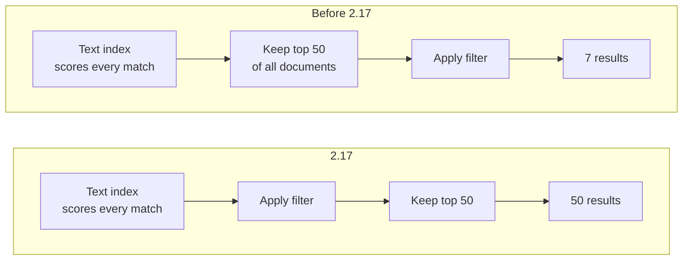
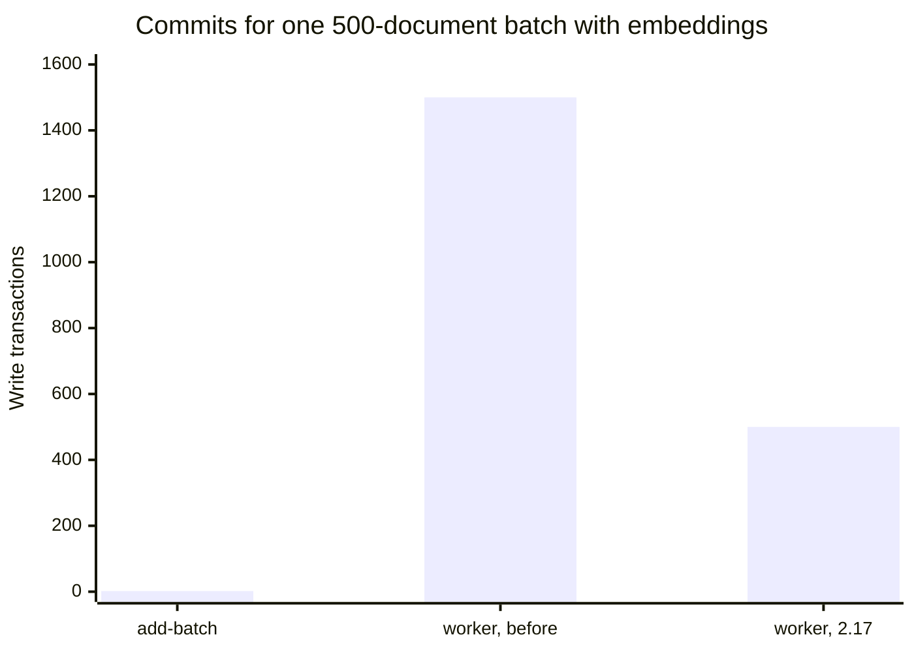

A crash is a gift. It tells you where, roughly when, and usually why. The bugs
that cost the most are the ones that return 200, write a reasonable-looking
file, and let you find out weeks later.

Looking back over the last three releases of MDDB, 2.15.4 to 2.17, nearly
everything we fixed was of that second kind. None of it threw an error. Each
one was found because someone running MDDB for real looked at a number and
thought it was a little off.

## The backup that wasn't (2.15.4)

`POST /v1/backup` returned a file. The file had the right size. It opened.
It could not be restored.

The HTTP and MCP backup paths copied the database file while writes were
still landing. bbolt writes pages, then a meta page that points at them, so a
plain file copy taken mid-write mixes pages from different commits. Usually
you get away with it. Sometimes bbolt notices, at restore time, that the free
page list is out of order, and refuses.

That alone would have been an annoyance. What made it dangerous was what
restore did next. It checked the backup by opening it read-only, which skips
the very walk where a damaged file fails. So the bad backup passed, the live
database was moved aside to make room, and the panic arrived after the point
where we could still roll back. The server was left with no database at all.

2.15.4 copies through a read transaction on every path, the way the gRPC
backup already did. Every backup now runs bbolt's full integrity check before
it is kept, in a separate process so a panic on a damaged file cannot take the
server down with it. And because a consistent copy of a healthy database
always passes that check, a failed check now tells you something more useful:
the *live* database is damaged, and you are finding out while it still serves
traffic rather than at the next restart.

If you already have backups from before 2.15.4, `mddbd -verify-db FILE` will
tell you whether they are good.

## The log where every line was the same (2.16)

The operator of a public MCP server on MDDB asked a simple question: what do
people search for, and what do they search for that we don't have?

The log could not say. Request logging recorded method, path and status, and
every MCP tool call is a `POST /mcp` that returns 200. A lookup that found the
package and a lookup for something the database had never heard of produced
identical lines.

2.16 writes one record per tool call with the tool name, the query, how many
results came back, how long it took and who asked. It also adds three
counters, so "how many lookups found nothing today" is a Prometheus query
rather than a grep:

```promql
rate(mddb_operations_total{operation="mcp_tool_miss"}[1h])
```

That miss rate is the number the operator wanted. It is a list of things
users expected to find.

## The filter that kept 7 of 100 (2.17)

This one is the most embarrassing, because it was in the most ordinary
request MDDB serves.

A ports search site filters by system, repository, category and maintainer.
It sends a query, a filter and `limit: 50`. Here is what happened to that
request:



The filter ran after the limit. It could only choose among the 50 documents
that ranked best across the whole collection, so a category whose ports
ranked lower simply had fewer results, or none. In a test with 100 documents
matching both the query and the filter, the response held 7.

Nothing about that response looked broken. Seven results is a plausible
answer. You would only notice if you already knew the right one.

The fix is one moved line. The index was already scoring every match before
cutting its sorted list to the limit, so asking it for all of them costs
nothing extra. `rangeMeta` and `boost` had the same order and got the same
fix, which has a nice side effect: a boost can now lift a document from below
the limit to the top, which is the only reason anyone uses a boost.

While in there, we added the feature the same site had asked for:
`"facetScope": "all"`, which counts facets over every match rather than the
returned page, plus a `matched` count for the "1,525 ports found" line.
Counted from the metadata index, it takes 11 ms over nearly 20,000 matches.

## The fsyncs nobody was paying for (2.17)

On SSDs, bulk loads were fine. On a ZFS mirror of 7,200 rpm disks the same
load ran at 125 documents a second, and the process spent half its time in
`fsync`.

The first guess, in the bug report and in our heads, was `add-batch`. It was
wrong. Counting commits directly, by reading the transaction ID off the
database's meta page before and after each request, showed `add-batch` doing
exactly what it should: two commits per request, whatever the batch size.

The commits were coming from somewhere nobody was looking: the embedding
worker, running in the background after the request had already returned.
After storing a document's vectors, it opened two more write transactions to
clean up chunks the document no longer had. Documents almost never shrink, so
those transactions were nearly always empty. Each one still cost an fsync.



2.17 looks before it writes, and writes once only when there is something to
remove. There is also a new counter, `mddb_db_write_transactions_total`, so
the next person with slow disks can see the commit rate in a dashboard
instead of reaching for dtrace.

## And one that wasn't ours (2.16.1)

Go 1.27.3 shipped fixes for twelve standard-library vulnerabilities in the
HTTP, HTTP/2, TLS and template code that `mddbd` uses on every request. 2.16.1
is that rebuild and nothing else. If your MDDB is reachable by clients you do
not control, it is worth the restart.

## What the four have in common

Every one of these produced a result that looked right: a file, a log line, a
list of seven ports, a load that finished. What found them was not a test
suite. It was people running MDDB on real data and asking why a number was
what it was.

So if something in MDDB looks merely a bit off — slower than it should be,
fewer results than you expected, a log that does not tell you what you need —
please [open an issue](https://github.com/tradik/mddb/issues). Most of what
is in these releases started as exactly that.

The full details are in the
[changelog](https://github.com/tradik/mddb/blob/v2.17.0/CHANGELOG.md).
