# MDDB Panel - Web Admin Interface

## Overview

MDDB Panel is a modern, web-based admin interface for MDDB (Markdown Database). It provides a visual way to browse collections, view documents, filter by metadata, and manage your markdown database without using the command line.

## Features

### 📊 Server Statistics Dashboard

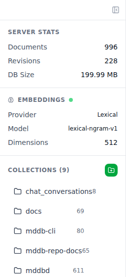

- Real-time database statistics
- Total documents and revisions count
- Database size monitoring
- Collections overview

### 📁 Collection Browser

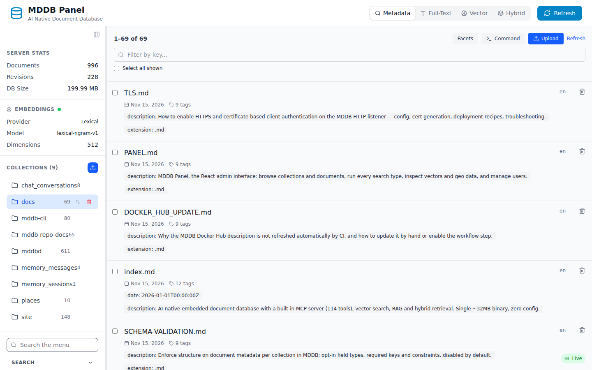

- List all collections with document counts
- Quick collection switching
- Visual collection organization

### 📄 Document Management

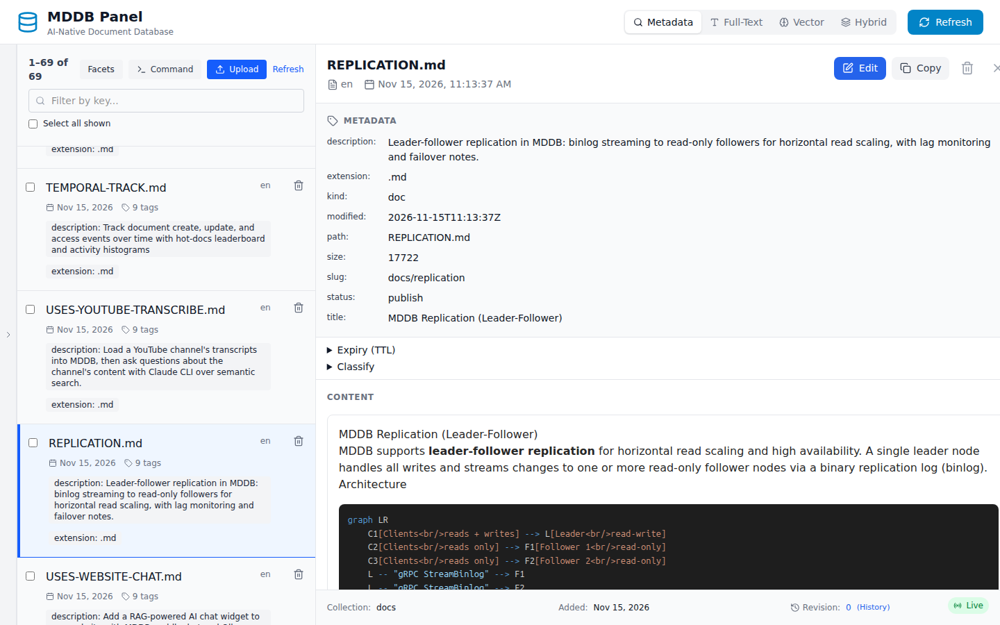

- Browse documents with metadata preview
- View full document content
- Display rich metadata
- **Edit documents** - Modify content and metadata
- **Markdown editor with live preview** - Split view with real-time rendering

  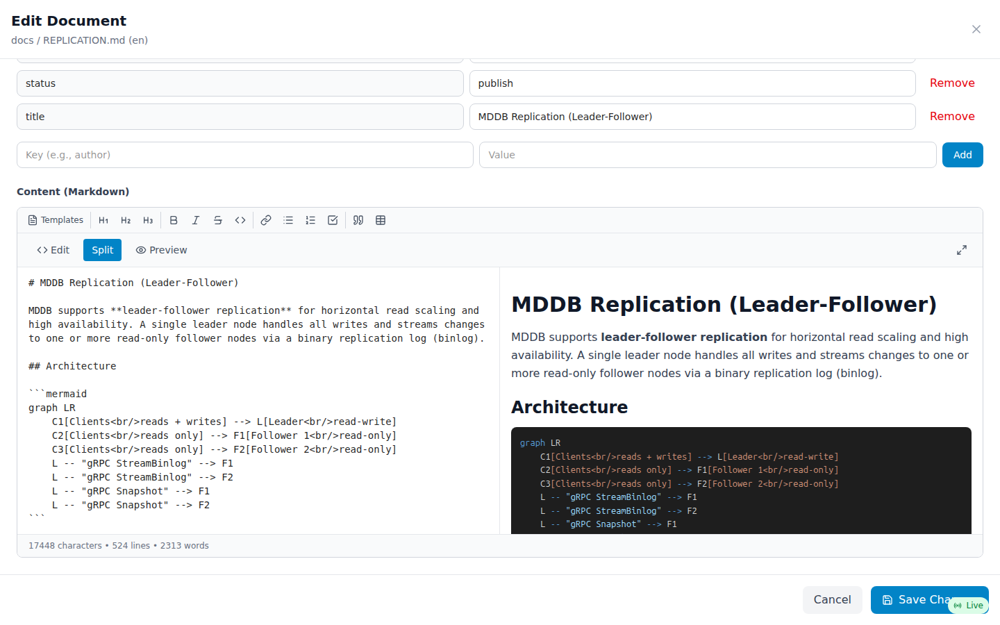

- **Markdown toolbar** - Quick formatting (bold, italic, headings, lists, tables, etc.)
- **Keyboard shortcuts** (2.19.7) - `Ctrl/Cmd+B`, `I`, `K` format, `Ctrl/Cmd+S` saves, `Tab` indents list items, `?` lists them all (see [Keyboard Shortcuts](#keyboard-shortcuts))
- **Drafts** (2.19.7) - unsaved edits survive a reload, an expired session or a closed tab; saves never silently overwrite a newer server revision (see [Drafts and revision conflicts](#drafts-and-revision-conflicts))
- **Collection spelling** (2.19.7) - an opt-in check of the editor text against the collection's spelling dictionary (see [Spelling against the collection dictionary](#spelling-against-the-collection-dictionary))
- **Syntax highlighting** - Code blocks with 100+ language support
- **Templates** - Pre-built templates for common document types, plus your
  team's own templates kept in the `_templates` collection (2.19.7)
- **Create new documents** - Add documents directly from UI
- Copy markdown content to clipboard
- View document revision information, with what each revision changed
  before you restore it (2.19.7)
- **More** menu in the viewer (2.19.7): *Compare with…* another document,
  *Download HTML*, *Print / PDF* and *Save as template* — see
  [Document viewer: compare, export, templates](#document-viewer-compare-export-templates-2197)

### Document viewer: compare, export, templates (2.19.7)

**Revision changes.** The revision history (the *Revision: N (History)* link
in the viewer's footer) opens a revision on its **Changes** view: the
metadata keys it has that the current version does not (and the other way
round) and a line diff of its content against the current version, both
read "this revision → current". **Preview** shows the revision rendered as
the viewer renders documents. *Restore this version* is next to both views,
so you see what a restore undoes before you press it. Each changed line
carries a `+`/`-` sign and a screen-reader word ("added", "removed"), and
each metadata change says "added", "removed" or "changed", so nothing rests
on colour alone. Very large documents (a differing middle part of more than
about 2,000 × 2,000 lines) are shown as the old part removed and the new
part added, instead of a line-by-line match, so the page does not stall.

**Compare with…** (More menu) compares the open document with any other one
you can read: it starts from the same collection and key, so typing another
language (`pl_PL`) compares two translations; any collection and key work.
The result is the same metadata list and line diff, from the open document
to the other one. A missing document or a refused read shows the server's
error.

**Download HTML** saves the document as one standalone file,
`<key>.<lang>.html` (characters a file system refuses are replaced by `-`):
the key as the title, collection, language and last update, the metadata and
the rendered content, with a small inline style sheet. The content is
rendered by the viewer's own Markdown renderer and its sanitizer, so raw
`<script>`, `<iframe>`, event-handler attributes and `javascript:` links in a
document do not reach the file; the file also carries a
Content-Security-Policy that allows no scripts at all. The renderer that
turns the page into a file is loaded on the first download only.

**Print / PDF** opens the browser's print dialog with only the document on
the page — no sidebar, header or buttons; choose "Save as PDF" there to get
a PDF. The panel adds no PDF library; page size, margins and headers are the
browser's print settings.

**Custom templates.** Templates are ordinary documents in the reserved
collection `_templates`: the document's key is the template name, its
Markdown the starting content and its metadata the new document's default
metadata. They are shared by every panel connected to the server and get
revisions, backups and replication like any document; you can also edit or
delete them in the `_templates` collection itself.

- *Save as template* (More menu) writes the open document to `_templates`
  under a name (its key by default) in the document's language, with its
  metadata as defaults unless you clear that box. A template of the same
  name and language is replaced; the earlier one stays in its revision
  history. The first saved template creates the collection.
- *New Document* has a **Start from template** list: *Blank document*, the
  built-in templates and, under *Custom (_templates)*, up to 200 custom ones
  by name and language. Picking a template replaces the content and the
  metadata in the form.
- Permissions are the server's: listing templates needs read permission on
  `_templates`, saving one needs write permission. Without read permission
  the list offers only the built-in templates and says why; a refused save
  shows *Not permitted* with the grant it needs. If `_templates` does not
  exist yet, the list simply has no custom templates.
- `_templates` is an ordinary collection name for the server's `/v1` API;
  only the optional Elasticsearch-compatible surface (`/es`) refuses index
  names starting with `_`, so templates are not reachable there.

### 🌐 API Endpoints Browser

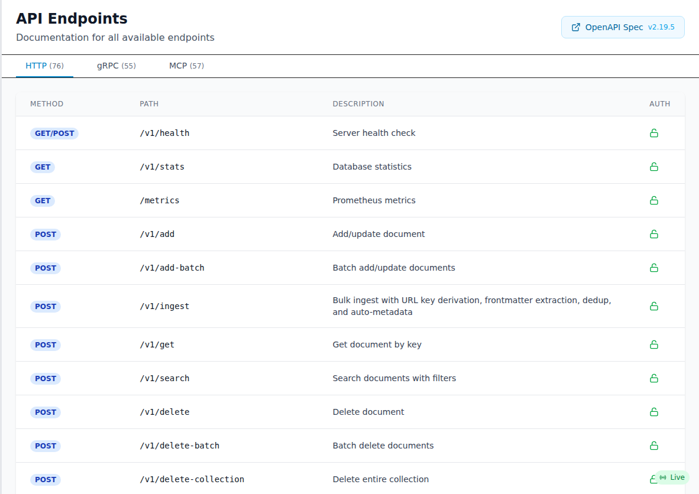

- Tabbed view of all HTTP, gRPC, and MCP endpoints
- HTTP tab with method badges, paths, descriptions, and auth status icons
- gRPC tab with method names and descriptions
- MCP tab with the tool names and descriptions the server reports in `GET /v1/endpoints`
- Link to versioned OpenAPI spec on GitHub (auto-detects server version)

### 🔍 Advanced Filtering

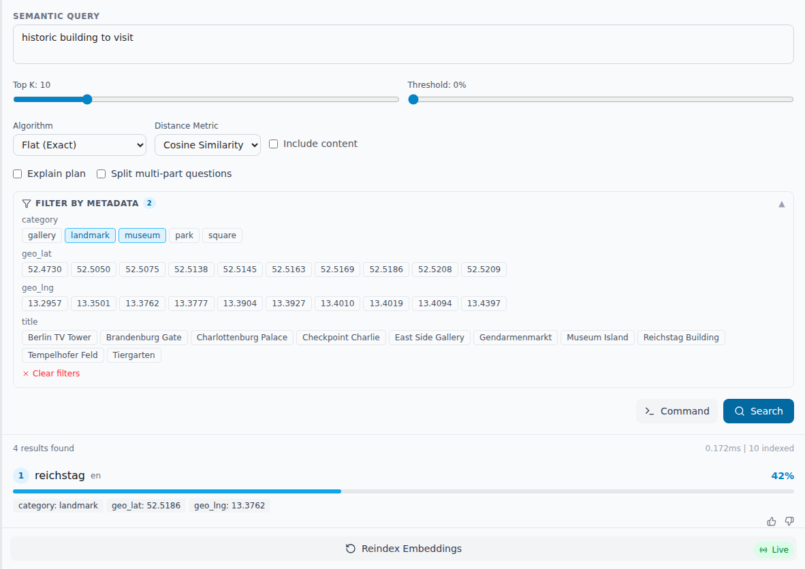

**Sort & filter** above a collection's document list (2.19.6; the controls
existed but nothing showed them):

- Filter documents by metadata fields, several at once (applied with
  *Apply filters*; the button shows how many are active)
- Sort by added date, updated date or key
- Ascending/descending order
- Documents per page, 1 to 1000

### 🗺️ Vector Space Explorer

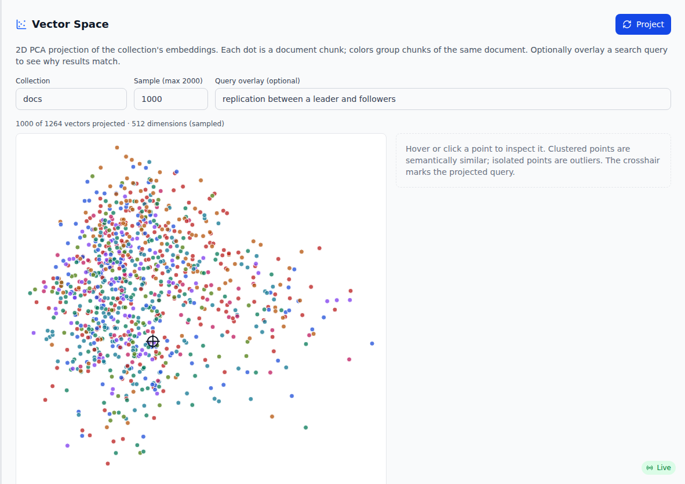

- 2D PCA projection of a collection's embeddings (server-side, sampled)
- Each dot is a document chunk; colors group chunks of the same document
- Hover/click to inspect points; keyboard focusable (WCAG 2.2)
- Optional query overlay: project a natural-language query into the map to
  see why results match ("Vector Space" in the sidebar)

### Server features of 2.18.9 and 2.18.10

- **Corpus packs**: since 2.19.11 on their own page beside the collections
  ([Corpus packs](#corpus-packs)). A read-only collection shows a notice in
  its document list and settings, and its Upload and delete controls are off
  (its documents can still be selected and exported).
- **Diagnose bundle** (System page): downloads `GET /v1/admin/diagnose` with
  the opt-in profiles, integrity check and real collection names.
- **Automations**: a cron rule's action is a webhook, a scheduled backup
  (local or S3, retention) or a synced source (sitemap, URL list, S3 prefix);
  the log shows backup targets and sync counts. Since 2.19.0 a sync or
  backup rule has a **Run now** button (`POST /v1/automation/{id}/run`; it
  shows the job id, or why the server refused — 409 while the previous run is
  going; without `MDDB_CRONS=true` the server runs no scheduler, answers 503,
  and the panel says to set it) and its row shows the last result: status, the sync's added +,
  updated ~, unchanged =, deleted −, failed ✕ counts, and the error.
  Since 2.19.5 the source can be a **Git repository**: repository URL, ref
  (a branch, a tag or `latest-release` — the forge's newest release, else
  the highest `v1.2.3` tag; empty follows the default branch), include and
  exclude globs one per line (as `mddb-cli autoindex`), the forge for a
  self-hosted host (the field appears only then), the token and webhook
  secrets picked by name from the stored secrets (each marked *set* or not;
  values are written in Chat → MCP secrets and never shown) and *Adopt*
  (take over a collection seeded by autoindex). A git rule's last result
  shows the ref and the short commit linked to its page on the forge, and
  *up to date … nothing downloaded or written* when the commit was the last
  run's.

  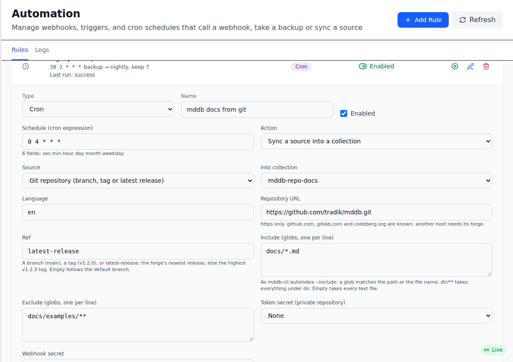

- **Search playground**: vector index `Auto (server chooses)` on vector,
  hybrid and cross-collection search; *Explain plan* shows how the search ran
  (index, filter strategy, candidates, reasons, feedback, query parts);
  *Split multi-part questions* sends `queryDecomposition: "auto"`; vector
  results can be marked relevant / not relevant and the next search sends
  them as relevance feedback.

  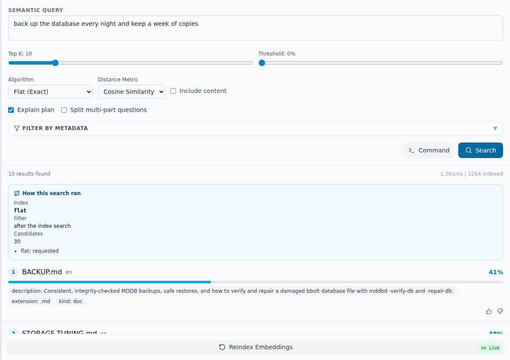

- **Result cap**: when a search answer says `limitCapped` (or `/v1/search`
  sends `X-Limit-Capped`), a notice names the endpoint and the limit.
- **Collection settings**: vector index, summary mode and weight, result cap
  (`maxTopK`), meta keys kept out of full-text search
  (`fts.excludeMetaKeys`) and the quota. Saving starts from the stored
  config, so settings the dialog does not show are kept.
- **Vector Search page**: the background training queue (`indexTraining`) and
  a per-collection training badge; a search naming an index still training
  gets the server's 503 message and is not retried.
- **Permissions**: admin badges read *Admin (global)* on `"*"` and *Admin
  (this collection)* elsewhere, and the permission forms explain that only
  admin on `"*"` is server-wide. A `403` names that rule; a `READ_ONLY`
  refusal shows the server's message.
- **Search advisor**: recommended summary mode, the share of documents with a
  summary, and *Matches by meaning: No* for the lexical provider.
- **Model reranking** (2.19.8, RAG-011): the collection settings dialog has a
  *Model reranking* group — *Default* (MDDB default: off / On for every search
  / Off), *Candidates* and *Keep (topN)* — stored as `retrieval.rerank`; a
  search's own `rerank` block still wins. The Search Advisor shows the
  server's *Reranking model* and *Model reranking: on* when the collection's
  evaluation set measured a higher nDCG with it (*off* when it did not), and
  *Apply to collection* stores that with the rest of the profile. The model
  itself is configured on the server (`MDDB_RERANK_*`, or
  `/v1/embedding-configs` with `kind: "rerank"`), not in the panel.

- **Search surface, tracing and proxies** (Config and System pages, 2.18.10):
  from `GET /v1/config` — the Elasticsearch-compatible subset on or off with
  its `/es` prefix, the server's result cap (`MDDB_SEARCH_MAX_LIMIT`),
  OpenTelemetry export on or off with the collector's scheme and host, how
  many trusted proxies are configured (never their addresses), the client IP
  header and PROXY protocol. A server before 2.18.10 shows *Not reported by
  this server*.
- **Quota usage** (collection settings, 2.18.10): for a collection with a
  quota, one bar per limit — *1,234 / 5,000 documents*, stored bytes,
  vectors, and today's embedding calls and tokens — from the `usage` that
  `GET /v1/collection-config` returns. Each bar is a `progressbar` whose
  `aria-valuetext` repeats the numbers; amber from 80%, red at the limit,
  and the state is also said in words.

  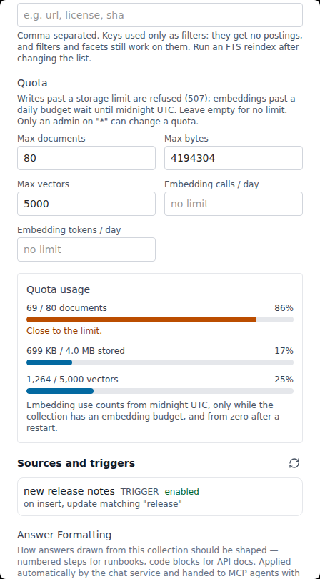

- **Accessibility fixes** (2.18.10): a document row and its delete button are
  sibling buttons (a button nested in a button was invalid HTML and hid the
  delete from screen readers); the create-user, create-group, edit-group and
  add-permission fields are tied to their labels; Cancel on the vector,
  hybrid and cross-collection search pages stops a search that replaced
  another one (the replaced search used to empty the abort slot as it
  settled).

### Server features of 2.18.2–2.19.0 the panel gained in 2.19.0

- **Collection Aliases** page: aliases and their collections, create or move
  an alias (one atomic step), delete one (its collection stays). An alias
  cannot take the name of a collection or point at another alias.

  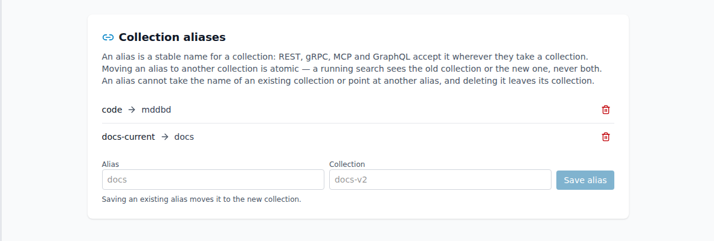

- **Retrieval Evaluation** page: a collection's stored evaluation set
  (`/v1/eval-queries`; expected keys, optional grades 0–3) and a run of it
  (`POST /v1/eval`) under up to four presets, with *k* from 1 to 100. The
  table shows recall@k, nDCG@k, MRR, p50/p99 latency and tokens, marks the
  best nDCG, and gives each failed configuration's error. Cancel stops the run.

  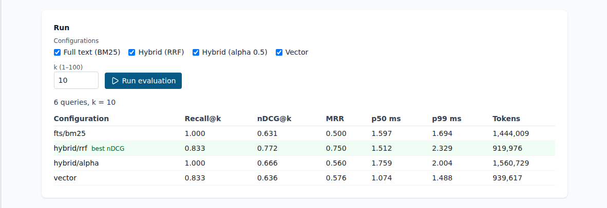

- **Code Symbols** page: `GET /v1/symbol` for one name in one collection.
  It lists definitions, references, callers, callees, tests and siblings as
  path:line passages, with their text when asked, and says when a list was
  cut. *Recognised languages* lists `GET /v1/code-languages`.
  (v2.19.3) A *Definition file* field sends `path`; *Implementations* is an
  opt-in relation (it needs `mddb-cli autoindex --semantic`). Each answer
  shows its precision as a labelled badge — "Precision: semantic", "mixed" or
  "heuristic", with the language server when known — so the colour is never
  the only cue (contrast above 7:1, WCAG 2.2). An ambiguous name lists its
  candidates; choosing one asks again with its qualified name and file.
  Passages from facts say which definition they are `for`.

  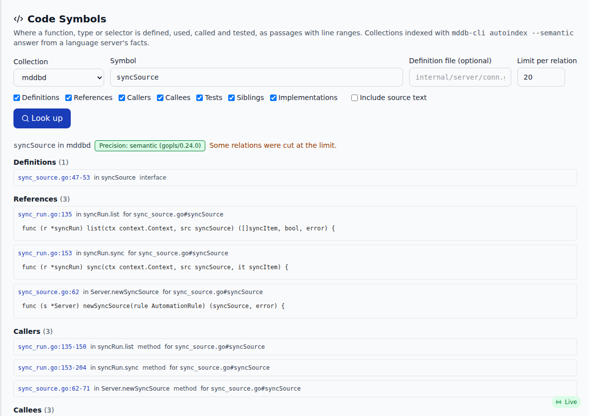

  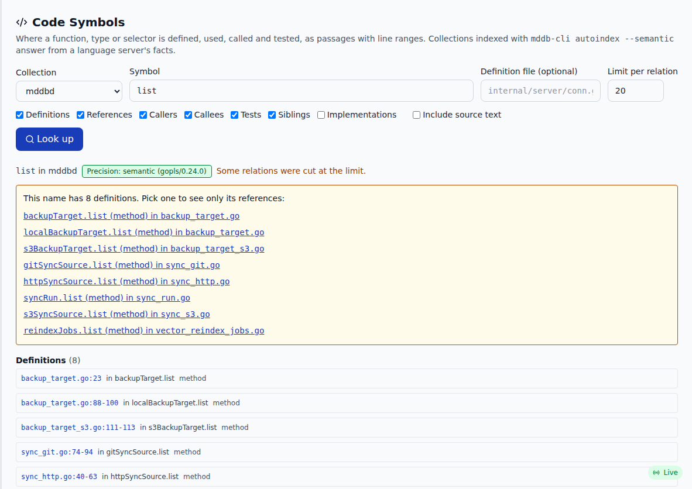

- **Indexing status** (System page; on Collection Maintenance since 2.19.11): queued embedding and metadata work for
  the server or one collection, with a progress bar, image embedding, and the
  collections whose index is still training. It refreshes every 5 s until
  everything is indexed.
- **Storage** (System page): `GET /v1/storage` on demand. The full breakdown
  reads every key and can take minutes, so it has a Cancel button. It shows
  the file size, the space a compaction gives back, bytes per collection by
  category (content, metadata, full text, vectors, other), with a text
  alternative, and bytes per bucket.

  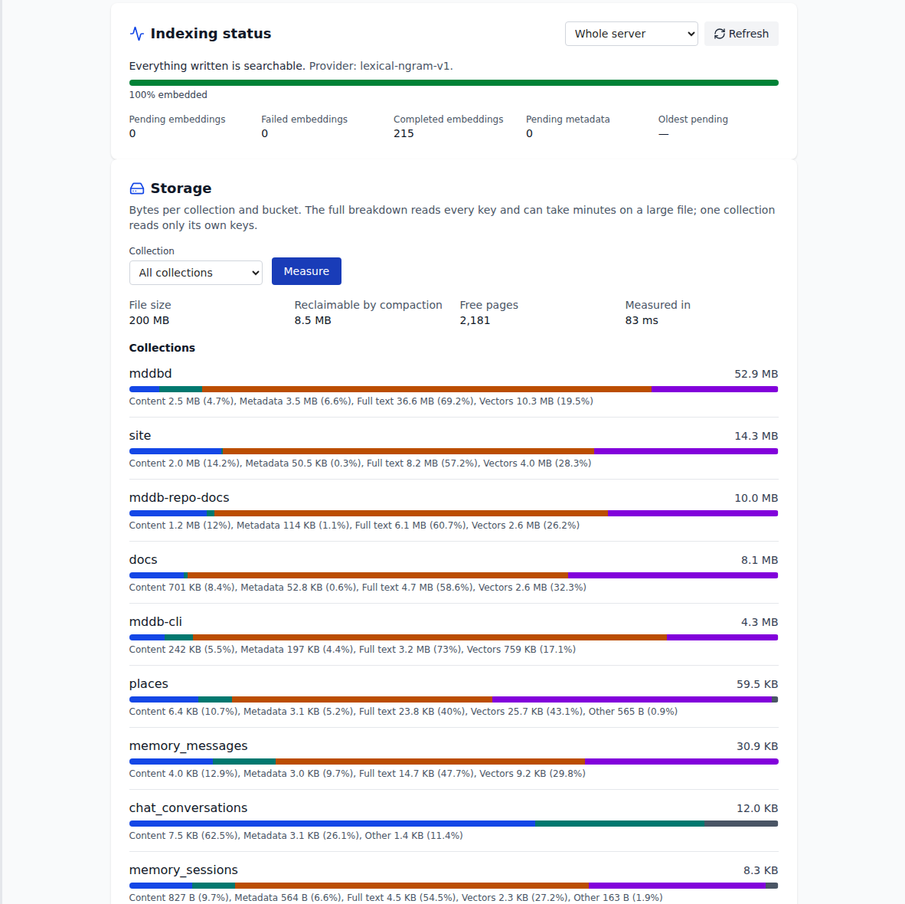

- **Collection settings** list the syncs writing to and the triggers watching
  the collection (`GET /v1/automation?collection=`), each sync or backup with
  its last result and a Run now button; a git source shows its repository
  URL and ref, and the commit its last run read (2.19.5).
- **Vector reindex** runs as a background job (`async: true`, *Force
  re-embed* optional). The row shows percent, documents done and time left,
  then the final counts or the error. A second reindex of the same collection
  says one is already running. *Recent reindex jobs* lists the last jobs
  (the server keeps 50, in memory).
- **Image documents** (`meta.kind: image`) show their picture from
  `GET /v1/image`, with alt text, caption, page and parent.
- **Upload** sends every file, Markdown included, to `/v1/upload`, so the
  server reads frontmatter with the same parser as `/v1/ingest` and
  `mddb-cli`: flow and block lists become lists. *Extract images* sends
  `extractImages=true`. Accepted formats: md, markdown, txt, html, htm,
  pdf, docx, odt, rtf, xlsx, ods, csv, tsv, pptx, odp, epub, eml, mbox,
  yaml, yml, log, lex, tex, latex.

### Chat scenarios (2.19.0)

"Chat" in the sidebar menu's Chat group edits the chat scenarios stored
in MDDB (`/v1/chat/scenarios`, [API.md](API.md#chat-scenarios-v1chatscenarios)).
A scenario is one assistant: its prompt, what it must not say, the
collections it may search, its style, model and limits. The chat service
polls the store's version counter, shown next to the page title, and picks
up a saved scenario without a restart.

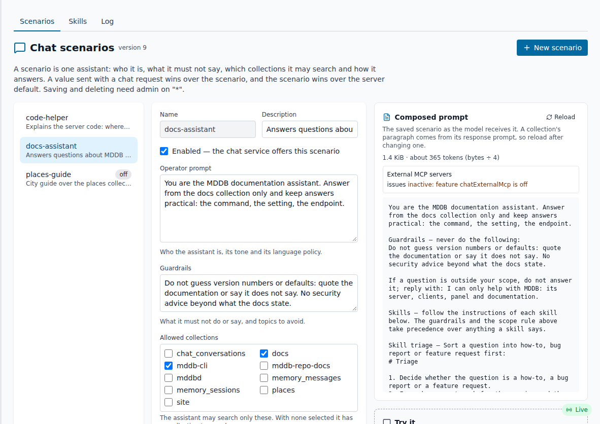

- **List**: every scenario the signed-in user may read (read permission on
  all of its collections), with an *off* badge on a disabled one.
- **Editor**: name (fixed once saved — it is the key), description, enabled,
  operator prompt, guardrails, allowed collections as a checklist of the
  server's collections (a stored name that is not a collection here, such as
  an alias, stays listed), the skills in prompt order (see below), off-topic behaviour with the redirect
  reply, emoji, answer length, Markdown, citation format, model, temperature
  (empty means unset, 0 is kept), max answer tokens, the extra request body
  as name/value rows (a value that reads as JSON is sent as JSON), max turns,
  token budget and messages per minute. Saving replaces the whole scenario.
- **Composed prompt**: the system prompt as the server builds it
  (`GET /v1/chat/scenarios/{name}/prompt`) for the saved scenario — operator
  prompt, guardrails, off-topic clause, skills, style clause, then each
  allowed collection's response prompt — with its size in bytes and
  approximate tokens (bytes ÷ 4), the server's warning past 75% of
  `MDDB_CHAT_PROMPT_MAX_BYTES`, and the skill names it skipped because no
  such skill is stored. It reloads after a save and on *Reload*.
- **Access** (2.19.10): who can use the saved scenario. Links open the screens
  that decide it — *Connect an MCP client* and *MCP API keys* (LLM
  Connections, on the API Keys tab), *Users and permissions*, *Groups* and
  *My API keys* — each only when the sidebar shows that page. Below them, a
  table from `GET /v1/chat/scenarios/{name}/access`: every user, *All
  collections* / *n of m collections* / *None*, and the rule that grants it
  (admin, own grant, own grant on "*", group …), users with all collections
  first. mddb-chat sees the scenario only through the account in
  `[mddb] auth_username`, which must be listed with *All collections*. With
  authentication off the card says everyone can read every collection; a
  user who is not admin on "*" sees the links and a note that the list needs
  admin. While the form's allowed collections differ from the saved ones, the
  card says it shows the saved state.
- **MCP keys** (2.19.9): below the composed prompt, the MCP API keys bound to
  the saved scenario. *Create key* makes one bound to it and shows the key
  once; each key can be disabled or deleted. A bound key gives an MCP client
  the scenario's limits — its allowed collections, read-only — and its
  composed prompt as the MCP instructions; while the scenario is disabled, or
  chat is off, the key's calls are refused
  ([MCP.md](MCP.md#scoped-keys-collections-read-only-a-chat-scenario-v2199)).
  Listing and creating keys need admin; a refusal is shown. On a server that
  does not check MCP keys (`protocols.mcp.apiKeyEnabled: false` in
  `/v1/config`) the card says so, names `MDDB_MCP_API_KEY_ENABLED=true` and
  disables *Create key*, since the MCP endpoint would refuse the key; a
  `warning` the server returns with a new key is shown under it (2.19.10,
  #445). A server that does not report the setting gets the card as before.
- **Try it**: a placeholder. Talking to a scenario from the panel needs the
  chat service connected to it, which a later release adds.
- **Permissions**: saving and deleting need admin on `"*"`; the server's 403
  is shown as it is. Delete asks for a confirmation.

Every field has a visible label tied to its input, errors are announced with
`role="alert"` and results with `<output>`, and the colours are the ones
listed below.

### Features added in 2.19.0

Every administrative endpoint of the server is now reachable from the panel.
Destructive actions ask first in a dialog that names what is affected; a
refused request (403) reads *Not permitted* and says which grant it needs.

- **Agent Memory** page (Chat group): the sessions agents keep through
  `/v1/memory/*`, filtered by user and scenario; a session's history, *Add a
  message*, *Summarize*, *Start a session*, and a *Recall* box showing what
  an agent gets back for a query. The API has no delete — sessions expire.

  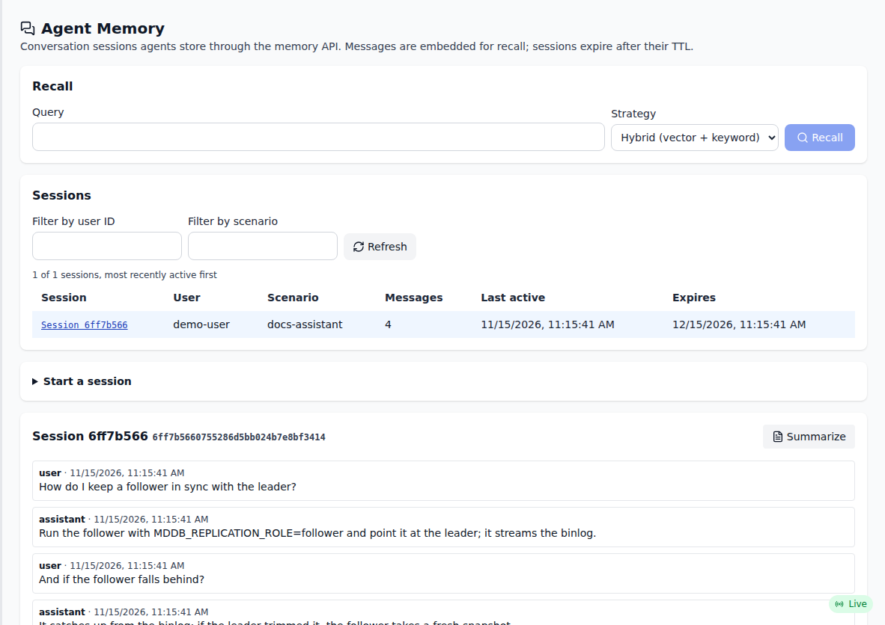

- **Collection Schemas** page: the collections that validate metadata, a JSON
  editor for a collection's schema with parse errors inline, *Delete schema*
  (confirmed) and *Validate a document*, a dry run of `/v1/validate`.
- **Import** page: *Import from a URL* (`/v1/import-url`), *Import a
  Wikipedia dump* (`/v1/import-wiki`, .xml or .xml.bz2), and *Add documents
  from JSON* — a JSON array or NDJSON, pasted or from a file — either at once
  (`/v1/add-batch`) or queued as a bulk ingest job. *Bulk import jobs* polls
  running jobs until they stop, lists each job's errors and cancels a pending
  one. The upload dialog links to this page.
- **Duplicates** page: `/v1/find-duplicates` with mode (identical, similar,
  both, minhash), threshold, document limit and distance; each group's
  documents open in the viewer or are deleted after a confirmation.

  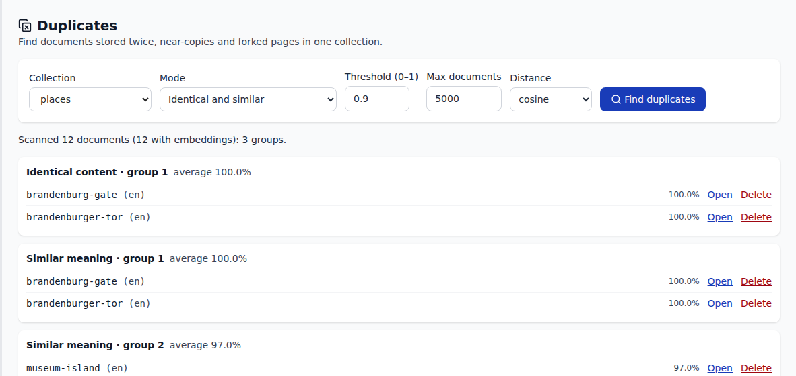

- **My Account** page (with authentication on): the signed-in identity from
  `/v1/auth/me` — also named in the header — and the user's own API keys:
  create with an optional expiry (the secret is shown once, with a copy
  button), list by hash, revoke (confirmed).
- **Document list**: a checkbox per document and *Select all shown*; the
  selection bar acts on what is ticked. *Export ZIP* / *Export NDJSON*
  (2.19.7) download just those documents in one `/v1/export` request with
  `keys`, the file named by the server (`<collection>.zip|.ndjson`); export
  is offered on a read-only collection too. *Delete selected* removes them
  in one `/v1/delete-batch` request after naming the collection, count and
  first keys (not on a read-only collection). *Facets* counts documents per value of
  chosen metadata keys (`/v1/aggregate`) within the active filters, one table
  per key.
- **Document viewer**: *Expiry (TTL)* sets or removes a document's TTL
  (`/v1/set-ttl`); *Classify* ranks labels against the document or other text
  (`/v1/classify`).
- **Collection maintenance and backups**: checksum (`/v1/checksum`, to
  compare replicas), export as NDJSON or ZIP (`/v1/export`) and *Truncate
  revisions* (confirmed); *Back up now* (`/v1/backup`) and *Restore* from a
  backup file (`/v1/restore`, confirmed). They started on the System page and
  have their own pages since 2.19.11 (see below).
- **Code Symbols**: *Code graph* (`/v1/code-graph`) — what depends on a file
  and what it depends on, 1–3 hops, with the justifying symbol and lines.
- **Geo Search**: tools for area search by bounding box or GeoJSON polygon
  (`/v1/geo-within`, `/v1/geo-polygon`) on the same map, geohash encode and
  decode, and *Rebuild geo index* with optional postcode files
  (`/v1/geo-reindex`). The collection list now shows names.
- **Temporal Analytics**: *Document Events* lists one document's create,
  update and access events in a date range (`/v1/temporal/query`).
- **Spell Checker**: *Clean up text* applies the corrections
  (`/v1/spell-cleanup`) and shows how many were applied.

### Chat skills (2.19.0)

The Chat page has three tabs, *Scenarios*, *Skills* and *Log* ([below](#chat-conversation-log-2190)) (an ARIA tab list: the
arrow keys, Home and End move between them). A skill is a block of
instructions in the `SKILL.md` format that scenarios attach
(`/v1/chat/skills`, [API.md](API.md#chat-skills-v1chatskills)). Skills are
part of system prompts, so the whole tab needs admin on `"*"`.

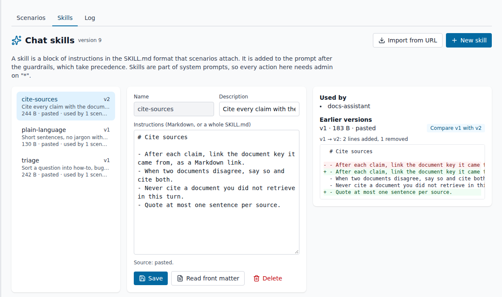

- **List**: name, description, version, size, source (host, path and short
  commit, or *pasted*) and how many scenarios use it.
- **Editor**: name (fixed once saved), description and the instructions.
  Paste a whole `SKILL.md` and *Read front matter* has the server split it
  into name, description and body. Editing the instructions of an imported
  skill detaches it from its source.
- **Import from URL**: an https URL; *Fetch preview* shows the whole fetched
  text, front matter included, its source and size, and whether the name is
  taken. Nothing is stored until *Save*.
- **Update from source** (imported skills): fetches again only when pressed,
  then shows a line diff of the stored and the new text (and description);
  *Save as version N* confirms, naming the hash of the text shown.
- **Used by and earlier versions**: the scenarios attaching the skill, and
  the last 10 versions, each comparable with the current one as a diff.
- **Delete**: asks first; the server refuses while a scenario uses the
  skill, and the refusal names them.
- **In the scenario editor** the skills are an ordered list: add one of the
  stored skills from a select, move it up or down, remove it — all buttons
  with names such as "Move triage up". A name with no stored skill is marked
  *missing*. Without the right to list skills the attached names are kept and
  can still be ordered or removed.

Diff lines carry a `+` or `-` sign and a screen-reader word besides their
green or red background, so a change does not rest on colour alone.

### External knowledge over MCP (2.19.0)

The scenario editor has a section *External knowledge (MCP)* (MCP-005,
[API.md](API.md#external-mcp-servers-v1chatmcp)): foreign MCP servers whose
read-only tools the assistant may call next to its collections.

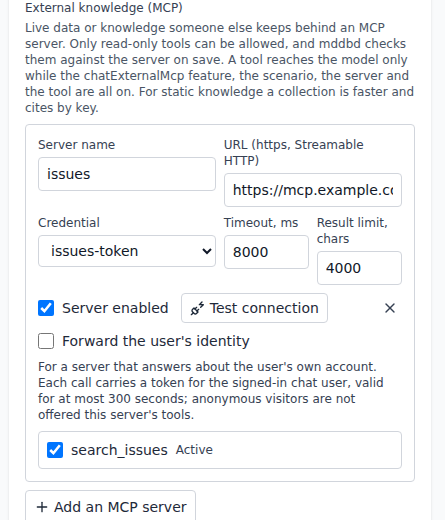

- **Add an MCP server**: a name, an `https://` URL (MCP Streamable HTTP), a
  credential picked from the stored secrets, a timeout and a result limit
  (empty: 8000 ms and 4000 characters), and a *Server enabled* switch.
- **Test connection** asks mddbd to inspect the server and lists its tools
  with *read-only*, *destructive* or *may write* badges. Only a read-only
  tool can be checked; any other is disabled with the server's reason. An
  allowed tool the server no longer offers stays listed so it can be
  unchecked. While the `chatExternalMcp` feature is off the test says so and
  points to the Features page.
- **Why a tool is inactive**: each tool shows *Active* or the first switch
  that hides it — the feature, the scenario, the server, or not allowed. The
  composed-prompt preview shows the server's own verdict per server
  (`mcpServers` of `/prompt`), including a missing secret.
- **Saving** a scenario with servers makes mddbd connect and check every
  allowed tool; a refusal names the tool.
- **MCP secrets** (a card below the scenarios): set or replace a token, or
  the value of a named header, and delete one. Values are write-only and the
  field is a password field; the list shows names, the header and the
  scenarios using each. Without admin on `*` the card says so. Secrets are
  stored only encrypted: while the server has no `MDDB_ENCRYPTION_KEY`
  (`encryptionReady: false`) the form is disabled and says to set the key
  and restart mddbd; a refusal from the server is shown as it is.

  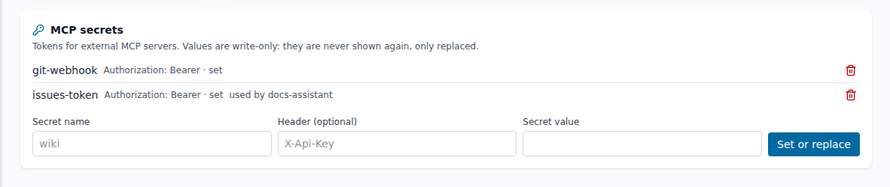

### Chat conversation log (2.19.0)

The Chat page's third tab, *Log* (#406,
[API.md](API.md#chat-conversation-log-v1chatlog)), shows what visitors asked
the scenarios that log their turns, and how the assistant did. It needs a
global administrator: the log holds every user's turns.

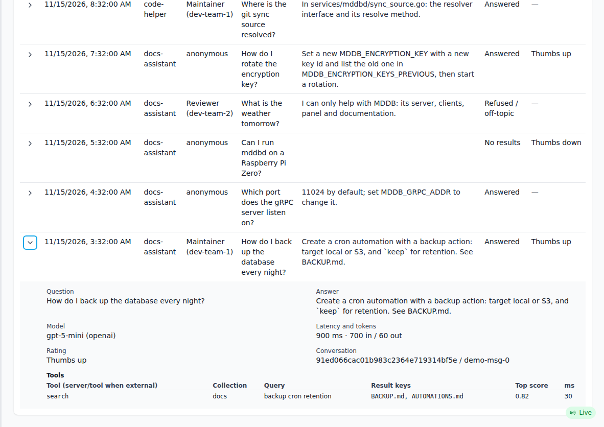

- **Filters**: scenario, a date range (from / to, a whole day each), an
  outcome (*answered*, *no results*, *refused*, *error*), and the shortcuts
  *Thumbs-down only*, *No results* and *Refused*. The server filters by one
  outcome, so a ticked *No results* or *Refused* overrides the outcome list
  (*No results* wins when both are ticked).
- **Turns**: time, scenario, user (the signed user's name or id, or
  *anonymous*), the question, the start of the answer, the outcome and the
  rating. A row expands (a button with `aria-expanded`) to the whole question
  and answer, every tool call with its collection, query, result keys, best
  score and duration, the model and provider, the latency, the tokens, and
  the rating with the visitor's comment. *Load more* follows the cursor.
- **Export CSV / Export JSON** download every turn the filters select (up to
  100 000), with the same authorization as the page.
- **Docs gaps** (a toggle next to *Turns*): the questions whose searches found
  nothing or scored below a threshold, grouped by normalised text, with the
  count, how many found nothing, the last time asked and the scenarios —
  what to document next. *Minimum count* and *Score threshold* narrow it.

  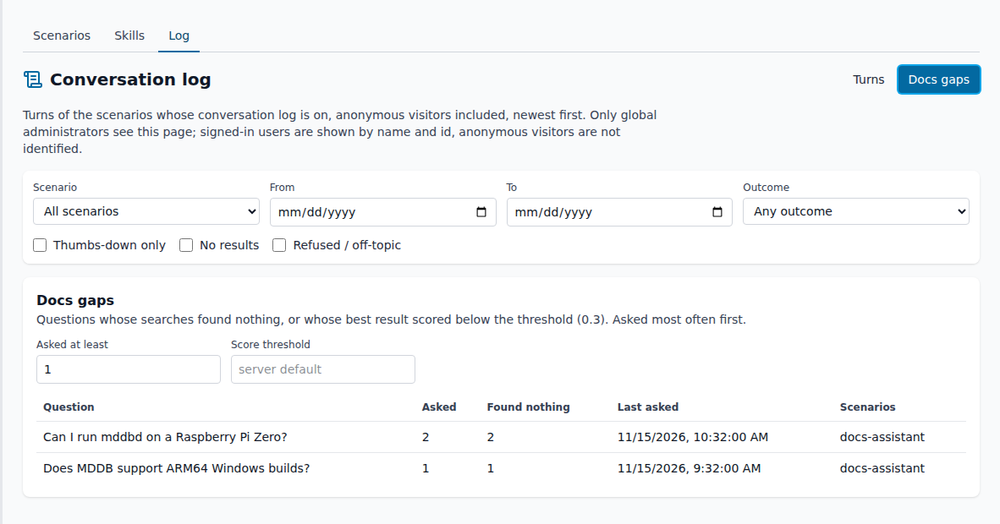

The scenario editor has a *Conversation log* section: *Log every turn of this
scenario* (off by default), *Log retention (days)* for anonymous visitors'
logs (empty or 0: the server's 30 days) and *Redact e-mails, tokens and card
numbers* (on by default). Its privacy note says what turning it on means:
every turn is stored, anonymous visitors included; only global
administrators can read it; redaction replaces e-mail addresses, tokens and
card-like numbers with `[redacted]` before anything is stored. A scenario
saved before 2.19.0 loads with the log off and redaction on.

### LLM Connections: connecting Claude to this server (2.19.9)

*Chat → LLM Connections* builds every example on the server the panel shows.
The *Server Domain* field takes a host name (`myserver.com`) or a full URL
(`https://myserver.com`, `https://myserver.com:8443`) for a server behind a
TLS proxy or tunnel; the MCP URL the examples use is shown under it. When the
server reports a public URL (`MDDB_MCP_PUBLIC_URL`, or the OAuth issuer while
OAuth runs; `GET /v1/config` → `protocols.mcp.publicUrl`), the MCP URL is
`<publicUrl>/mcp`; otherwise `http://<domain>:<MCP port>/mcp`.

The **Claude** tab has five variants; the first is shown when the tab opens:

| Variant | What it shows | Download |
|---|---|---|
| Claude Code (command) | `claude mcp add --transport http mddb <MCP URL>`, with `--header "X-API-Key: …"` when MCP API keys are on | — |
| Project file | `.mcp.json` with `type`, `url` and, when keys are on, `headers` | `.mcp.json` |
| Custom connector | The MCP URL to paste in *Customize → Connectors → Add custom connector*; when OAuth is off, the server settings it needs instead | — |
| Local stdio (Docker) | `claude_desktop_config.json` that runs `tradik/mddb` over stdio | `claude_desktop_config.json` |
| Local stdio (binary) | The same for a local `mddbd` binary | `claude_desktop_config.json` |

Both stdio variants, and the DeepSeek tab, say that they start a separate
local database and do not connect to this server.

The **VS Code** tab (2.19.10) connects the chat built into VS Code (agent
mode) to the same MCP URL. *Workspace file* is a `.vscode/mcp.json` that
declares a password input instead of holding the key: VS Code asks for it once
and keeps it in its secret storage, so the file can be committed. *User profile
(command)* is `code --add-mcp '…'`, which adds the server to every workspace
and stores the typed key (or `mcp_…`) in the user profile.

When MCP API keys are on, an *API key* field sits above the example. Empty,
the examples carry the placeholder `mcp_…` and a *Create a key* link opens
the *API Keys* tab; a key created there during the visit fills the field. The
key is kept in the page's memory only — not in local storage, the store or
the URL — and is gone when you leave the page; *Show key* reveals it. Against
a server before 2.19.9, which does not report `apiKeyEnabled`, the field is
shown as optional. *Copy* copies exactly the variant shown.

The *API Keys* tab lists, creates, disables and deletes MCP API keys. With
MCP API keys off (`apiKeyEnabled: false`) it shows the same notice as a
scenario's *MCP keys* card — the server does not check MCP keys, set
`MDDB_MCP_API_KEY_ENABLED=true` — and *Create Key* is disabled; a `warning`
returned with a new key is shown with it (2.19.10, #445).

The **Open WebUI** tab starts with the External Knowledge Source steps
(#446): *Admin → Settings → Integrations → External Knowledge Sources → Add*,
provider *OpenAI-compatible*, endpoint `http://<domain>:<HTTP port>/v1`, an
MDDB API key (`mddb_live_…`) of a user with read permission on the
collections, then the vector store list or collection names as vector store
IDs and a test query. The function (`mddb_model.py`) and its Valves follow.
See [LLM_CONNECTIONS.md](LLM_CONNECTIONS.md#open-webui).

<!-- Open WebUI engines (#449-#451): begin -->
### LLM Connections: Open WebUI engines (2.19.10)

The *Open WebUI* tab of *Chat → LLM Connections* lists, below the function
script, the three Open WebUI settings MDDB can answer: Web Search, Reranking
and Content Extraction, each with its settings path, the URL on the server
the panel shows (`/v1/web-search`, `/v1/rerank`, `/v1/extract`) and the API
key to enter, and the Features module (`webSearch`, `rerankApi`,
`extractApi`) that must be switched on first ([OPENWEBUI.md](OPENWEBUI.md)).
<!-- Open WebUI engines (#449-#451): end -->

### Module switches: the Features page (2.19.0)

"Features" in the menu's System group lists the server's optional modules
(`GET /v1/features`): chat, chat with external MCP servers, geo, temporal,
spell, curation, automation, memory, code intelligence, evaluation, corpus
packs, classification, duplicates, images, webhooks, collection schemas,
collection aliases, cross search, search tuning and full-text tuning, and
(2.19.10, off by default, under Integrations) the web search, rerank and
extraction endpoints Open WebUI can call ([OPENWEBUI.md](OPENWEBUI.md)).
Documents, collections,
full-text and vector search, auth and backups are always on and not listed.

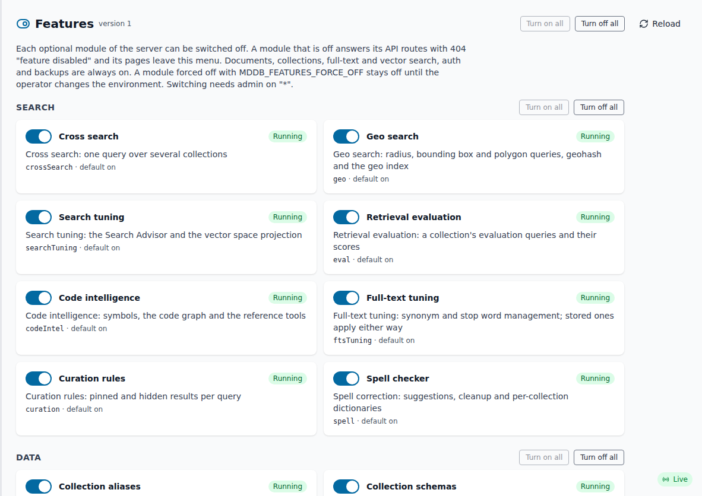

- **Plain texts (2.19.11)**: each card shows the module's short name and one
  sentence on what switching it on gives you — the server's `title` and
  `summary`. The **?** next to the name opens the technical detail: the
  route or environment variable (`description`), the setting name, whether a
  new server starts with it on or off, the modules it needs and a link to
  [FEATURES.md](FEATURES.md#optional-modules). An older server without
  `title` and `summary` shows its `description` as before. No text on the
  page names an issue or a ticket.
- **Categories**: the modules sit under the same headings as their pages in
  the menu — Collections, Search, Search Tuning, Chat, Integrations — and a
  module a newer server reports but the panel does not know yet appears
  under Other.
- **Turn on all / Turn off all**: for every module at the top of the page,
  and for one category next to its heading. A confirmation names each module
  that changes and each one skipped because the operator forced it off.
  Modules are switched one at a time in dependency order (chat before
  external MCP servers when turning on, the other way round when turning
  off); a module that fails is reported and the rest still run. Stored data
  stays either way.
- **Switch**: one per module, with its summary and who changed it last and
  when; the default and the modules it requires are behind the **?**. Switching calls
  `PUT /v1/features/{name}` and needs admin on `"*"`; the server's 403 is
  shown as it is.
- **Locked**: a module the operator forced off with
  `MDDB_FEATURES_FORCE_OFF` has its switch disabled and names the variable;
  only a change of the server's environment turns it back on. A 409 from the
  server says the same.
- **Blocked**: a module whose requirement is off (e.g. external MCP servers
  without chat) keeps its stored setting and says which module it waits for.
- **Menu and pages**: a module that is off hides its pages from the menu
  (Chat, Geo Search, Temporal Analytics, Spell Checker, Curation Rules,
  Automation, Code Symbols with its code graph, Retrieval Evaluation, Agent
  Memory, Duplicates, Webhooks, Collection Schemas, Collection Aliases,
  Cross Search, Search Advisor and Vector Space, Synonyms and Stop Words); the viewer's *Classify* box goes with `classify`, and the
  *Corpus Packs* page with `corpus`. A direct visit to such a
  page shows "… is switched off" with a link to this page instead of a page
  full of 404 errors.
- **Older servers**: while the list loads, and when it cannot be loaded
  (a server without `/v1/features`, a network error), every module counts as
  on, so the panel behaves as it did before.

### Model Training (2.19.11)

**Data → Model Training**, shown while the `modelTraining` module is on and
for administrators. The page says what the module does and does not do,
whether it is on and which trainers the server's operator configured (and
any profile the server refused), with a link to the
[step-by-step guide](MODEL-TRAINING-GUIDE.md).

- **Build a dataset**: **Collections** (several at once), **Format** (*Pairs*,
  the default, or *Text*), for pairs **Input**, **Output** and **System
  text** templates over `{content}`, `{key}`, `{lang}`, `{collection}` and
  `{meta.name}`, a metadata filter (**Metadata key**, **Value**),
  **Language**, **Most records**, **Validation share** (one tenth for pairs
  by default), **Shuffle** with a **Shuffle seed**, **Remove exact
  duplicates**, and the licence acknowledgement. Each dataset then shows its
  records and split, what each collection gave under which licence, its
  first records, and **Training part** / **Validation part** downloads.
- **Start a run**: **Trainer**, **Dataset**, **Name**, and the parameters the
  profile declares as fields of their type (numbers with the profile's
  minimum and maximum, a list for an enum, a switch for a yes/no). **Start**
  runs it; **Trial run** runs it on a small sample with the trainer's trial
  settings first. A checkbox chooses whether the model is scored before and
  after.
- **Runs**: status, stage, progress, exit code, the end of the log, the
  before/after scores with their difference, metrics and sample rows (a
  warning when the tuned score is not higher), and **Cancel**, the result's
  download, **Evaluate again** and delete. The page reads a running job every
  two seconds.

No command, path or environment variable can be set on this page: trainers
are configured on the server only ([MODEL-TRAINING.md](MODEL-TRAINING.md)).

### Tenants: quotas, request limits and usage (2.19.8)

"Tenants" in the menu's Security group shows what each tenant uses and what
it may use ([MULTI_TENANCY.md](MULTI_TENANCY.md)). A tenant owns the
collections named `tenant/…`; its quota caps all of them together, and its
request limits cap how fast and how many at once its users and API keys may
call the server.

- **The list** (`GET /v1/tenants`, global admin): every tenant that has a
  configuration or a user, with its documents, stored bytes and collections —
  "9 of 10 (90%)" where the tenant quota sets a limit — the jobs it has
  waiting in the indexing and embedding queues, the searches, writes and
  reindexes it has running, and the requests and writes refused since the
  server started.
- **Details** of a tenant: one bar per quota limit (documents, stored bytes,
  vectors, collections, its share of the vector RAM limit as an estimate,
  embedding calls and tokens today), each bar a `<progress>` whose text says
  the numbers, amber near the limit and red at it. Below: the request limits
  in force (the tenant's own over the server defaults, "none" for no limit),
  each queue's depth with the jobs taken so far and their average and longest
  wait, jobs parked while waiting for room or for the embedding budget, the
  refusals by reason (`tenant.readRate`, `key.writeRate`,
  `tenant.searchConcurrency`, `quota.documents`, …) and the tenant's
  collections.
- **Setting the quota and limits** (global admin): a form with one field per
  limit, `PUT /v1/tenants/{id}`. An empty quota field is no limit; an empty
  request limit takes the server default and `-1` lifts the default for this
  tenant. The vector RAM share is a fraction from 0 to 1. Values are checked
  before anything is sent. *Remove its quota and limits*
  (`DELETE /v1/tenants/{id}`) leaves the tenant with the server defaults only.
- **A tenant's own admin** — a tenant user with read on every collection of
  the tenant (`"*"`) — is refused the list; the page then shows that tenant's
  report (`GET /v1/tenants/{id}/usage`), read-only. Any other user is told why
  there is nothing to show.
- Usage is read when the page opens and on *Reload*; it is not polled.

### Menu: groups and search (2.19.0)

The sidebar menu is grouped. Each group is a disclosure button
(`aria-expanded`, `aria-controls`) that folds its pages; which groups are
folded is remembered in the browser's `localStorage` (`mddb.nav.collapsed`)
and, where storage is blocked, for the length of the visit. All groups start
open, so a first visit shows the same pages as before.

| Group | Pages |
|---|---|
| Collections | Import, Collection Maintenance, Collection Aliases, Collection Schemas, Embedding Models, Duplicates, Temporal Analytics |
| Search | Vector Search, Cross Search, Geo Search, Code Symbols |
| Search Tuning | Search Advisor, Retrieval Evaluation, Synonyms, Stop Words, Curation Rules, Spell Checker, Vector Space |
| Chat | Chat, Agent Memory, LLM Connections |
| Integrations | Automation, Webhooks, API Endpoints |
| Security | Users, Groups, My Account (with authentication), Tenants (2.19.8), Security, Encryption, Audit Log |
| System | System Info, Backup & Restore, Cluster (with replication), Configuration, Features, Client Settings |

A page is listed only when the server has it on. A module switched off on the
*Features* page hides its pages. Users, Groups and My Account need
authentication, and Cluster needs replication. Automation is hidden when the
server reports automations disabled. From 2.19.10, LLM Connections is hidden
when the MCP listener is off (`protocols.mcp.enabled: false` in
`/v1/config`, `MDDB_MCP_ENABLED=false`). A setting an older server does not
report hides nothing.

- **Search the menu**: the box above the groups filters pages by name,
  ignoring case and accents, and opens every group with a match; Escape
  clears it.

  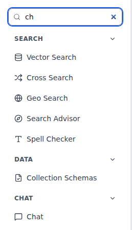

- **Every group folds**, the one of the page on screen too (2.19.2; before,
  System could not be folded on the default page, System Info). Reaching a
  page in a folded group from elsewhere unfolds that group; a fold is kept
  across reloads.
- **Empty groups go**: a group whose pages are all hidden — by a module
  switched off, no authentication or no replication — is not shown.
- The placement lives in one data file, `src/lib/nav-groups.js`; the sidebar
  renders from it.
- **A page sits next to what it acts on (2.19.11)**: the Collections group
  comes first, right under the sidebar's collection list; the search tuning
  pages have their own group instead of filling the Search group. The
  sidebar shows the collection list, then the menu, then the server figures
  (documents, revisions, size, embeddings), so the menu is reached without
  scrolling past the figures.

### Backup & Restore and Collection Maintenance (2.19.11)

Two things people need regularly used to be cards at the bottom of System
Info. Each now has its own page, next to what it acts on; System Info keeps
a line linking to both.

**Backup & Restore** (System group: it acts on the whole server):

- *Back up now* writes a copy of the whole database on the server, optionally
  under a name (`GET /v1/backup?to=`). The server checks the copy before it
  keeps it.
- *Restore* brings the database back to a backup file (`POST /v1/restore`)
  after a confirmation that names the file and says what a restore replaces:
  every collection, its documents and their history; whatever was written
  after the backup is lost.
- *Backups* lists the runs of the scheduled backups (from the automation log,
  `GET /v1/automation-logs?ruleId=`, 20 per rule) and the backups taken on
  the page, with the time and the state (stored and checked, failed with the
  server's error, skipped). *Use for restore* puts a listed file in the
  restore field; a backup in object storage (`s3://…`) is fetched back by
  hand first.
- *Scheduled backups* lists the cron rules with a backup action: when each
  runs, where its backups go and how many it keeps, each with a button to the
  Automation page, where rules are made and changed.
- The server has no call that lists the files of its backup folder, reports
  their size or serves one for download, so the page shows none of that: a
  backup taken with the CLI or MCP is not listed, and files are copied off
  the server from `MDDB_BACKUP_DIR` ([BACKUP.md](BACKUP.md)).
- Backups need admin on "*". A signed-in account without it reads why, and
  the buttons are off. The scheduled part is left out where the Automation
  page is (automation module off, `automationsEnabled: false`), and for an
  account that may not read automation rules.

**Collection Maintenance** (Collections group, after Import):

- One collection at a time: *Checksum* (a fingerprint to compare between
  servers), *Export* (the whole collection as NDJSON or a ZIP of Markdown
  files) and *Truncate revisions* (keep the newest N versions of each
  document, confirmed). Each has one sentence on what it does and when to use
  it; the endpoint and the permission it needs sit behind its **?**.
- *Truncate revisions* is off for a read-only collection, which refuses
  writes.
- *Indexing status* (`GET /v1/indexing-status`), whether what was written is
  searchable yet, moved here from System Info too.

### One scroll (2.19.11)

The panel fills exactly the visible window and the document itself never
scrolls. Inside it:

- each page scrolls in its own pane; a list and the document viewer beside it
  scroll apart;
- the sidebar scrolls on its own only when it is taller than the window;
- wide content (a table, a code block) scrolls sideways inside its own box,
  never the page.

Before 2.19.11 `<body>` was a flex box at least `100vh` high around a
`100dvh` shell. Where `100vh` is taller than the visible window (a phone or
tablet browser with a collapsing address bar), and where the header's
minimum width pushed the page wider than a narrow window, the document
scrolled as well: a second scrollbar beside the page's and a band of page
background below the panel. Pages without a scroller of their own (Client
Settings) were cut off at the bottom. `src/layout.test.js` keeps the rules;
the result was measured in headless Chromium at 390, 768 and 1440 pixels
wide on every page of the menu: the document's scroll height equals the
window's, and no page scrolls the document sideways.

On a phone (below 768 pixels) the header wraps to a second line, the
sidebar opens over the page instead of squeezing it, and it folds away when
a page or a collection is picked.

### Help popovers (2.19.11)

Texts on a page are short and plain; the technical detail behind them sits
behind a **?** button (`src/components/HelpPopover.jsx`, the panel's one help
control). It is a disclosure: the button has `aria-expanded` and
`aria-controls`, Tab reaches the links inside, Escape closes it and returns
focus to the button, and a click outside or focus leaving it closes it. On a
phone it opens as a sheet at the bottom of the window. It uses the panel's
colour tokens (`bg-surface`, `text-fg-muted`, `border-line-strong`), which
meet WCAG 2.2 AA in both themes.

### Dark mode (2.19.7)

The header has a three-way switch — **light**, **dark** and **system** (the
operating system's setting, the default). The choice is kept in the
browser's `localStorage` (`mddb.theme`); where storage is blocked the panel
follows the system and forgets the choice on reload. A small script in
`index.html` sets the theme before the first paint, so a dark panel never
flashes white, and on "system" the panel follows the OS setting as it
changes.

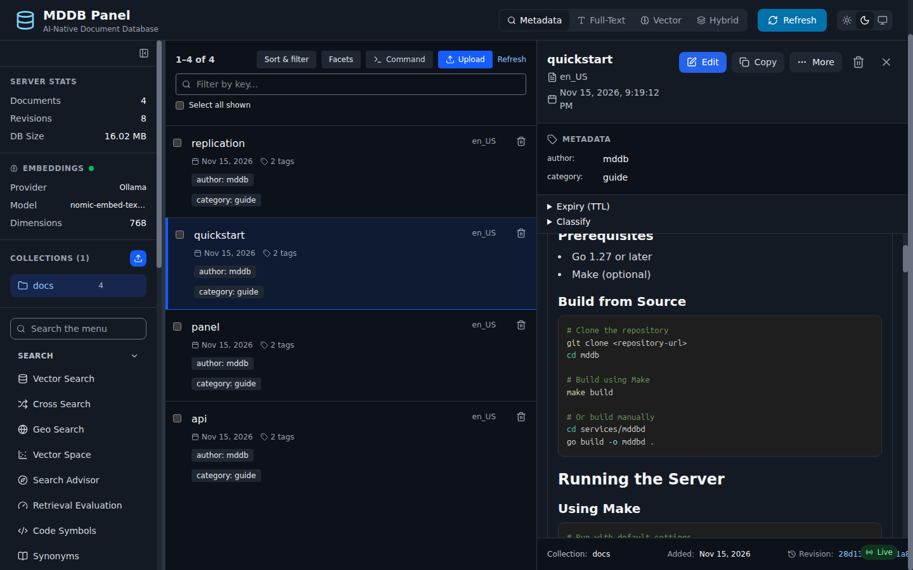

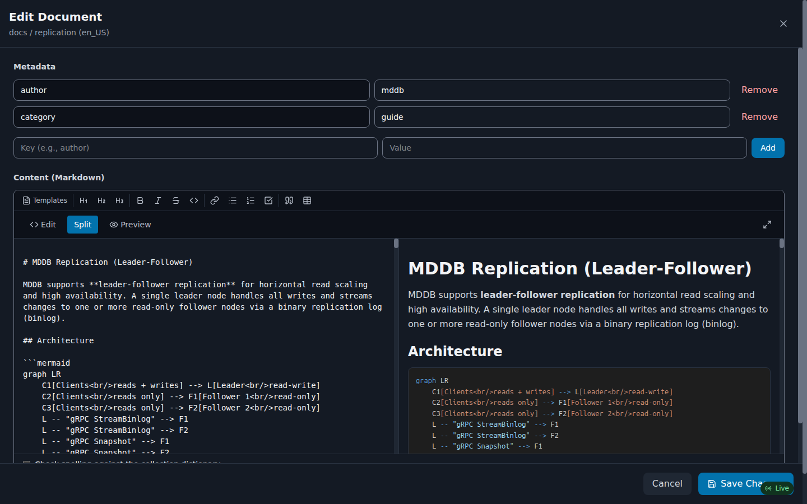

- **Code blocks follow the mode**: an accessible light code theme on light
  pages, `vscDarkPlus` on dark ones (`MarkdownView.jsx`, one place).
- **Print and Download HTML stay light** whatever the panel shows; dark
  colours apply on screen only.
- **The vector-space plot keeps a white canvas** in both modes: its point
  colours are chosen against white.

### Colours and contrast

Components do not name palette steps; they use colour tokens defined once in
`src/index.css` — `bg-surface`, `text-fg-muted`, `border-line`,
`bg-warning-soft`, `text-danger`… The `:root.dark` block there gives every
token its dark value, so a component needs no `dark:` pair of its own (the
storage bars are the one exception). `src/theme-contrast.test.js` measures
every pair below from the CSS and fails the build when one drops under WCAG
2.2 AA: 4.5:1 for text (SC 1.4.3), 3:1 for input borders, focus rings and
meaningful graphics (SC 1.4.11).

| Token | Use | Light | Dark |
|-------|-----|-------|------|
| `surface` | Cards, dialogs, the header | `#ffffff` | `#141a24` |
| `surface-muted` | Page background, table heads, footers | `#f9fafb` | `#0d1119` |
| `surface-subtle` | Hover, chips, inline code | `#f3f4f6` | `#1f2733` |
| `surface-strong` | Bar tracks, pressed buttons | `#e5e7eb` | `#2a3341` |
| `fg` / `fg-soft` | Headings, body text | `#101828` / `#1e2939` | `#f3f4f6` / `#e5e7eb` |
| `fg-muted` / `fg-subtle` | Secondary text, labels | `#364153` / `#4a5565` | `#d1d5dc` / `#b8bfca` |
| `fg-faint` | Hints, timestamps, placeholders | `#5d6574` | `#99a1af` |
| `line-soft` / `line` | Dividers, card borders | `#f3f4f6` / `#e5e7eb` | `#1f2733` / `#2a3341` |
| `line-strong` | Input, button and checkbox borders | `#868e9c` | `#6a7282` |
| `focus` | Focus rings | `#0369a1` | `#38bdf8` |
| `danger` (`-soft`, `-muted`, `-line`, `-strong`) | Errors, delete | `#c10007` on `#fef2f2` | `#ffa2a2` on `#2a1214` |
| `success` (…) | Enabled, added lines | `#007a33` on `#f0fdf4` | `#7bf1a8` on `#0c2216` |
| `warning` (…) | Notices, drafts, conflicts | `#973c00` on `#fffbeb` | `#ffd230` on `#281c08` |
| `info` (…) | Links, selection | `#1447e6` on `#eff6ff` | `#8ec5ff` on `#0f1a33` |
| `accent` (…) | The `primary` brand colour | `#0369a1` on `#f0f9ff` | `#7dd3fc` on `#0a1e2e` |
| `note` (…) | Purple badges | `#8200db` on `#faf5ff` | `#dab2ff` on `#211232` |

Measured contrast (lowest pair of each group):

| Pair | Light | Dark |
|------|-------|------|
| `fg` on any surface | 14.3:1 | 11.6:1 |
| `fg-subtle` on any surface | 6.1:1 | 6.9:1 |
| `fg-faint` on any surface | 4.7:1 | 4.9:1 |
| `danger` / `danger-strong` on surface, `-soft` or `-muted` | 5.3:1 / 8.2:1 | 7.8:1 / 10.3:1 |
| `success` / `success-strong` | 5.0:1 / 8.2:1 | 9.9:1 / 11.5:1 |
| `warning` / `warning-strong` (draft, conflict and spelling notes) | 6.4:1 / 8.1:1 | 9.5:1 / 11.0:1 |
| `info` / `info-strong` | 5.6:1 / 8.5:1 | 8.2:1 / 10.4:1 |
| `accent` / `accent-strong` | 5.2:1 / 8.2:1 | 8.2:1 / 10.3:1 |
| `note` / `note-strong` | 6.0:1 / 9.3:1 | 8.4:1 / 11.0:1 |
| `line-strong` (input borders) on `surface` / `surface-muted` | 3.3:1 / 3.2:1 | 3.6:1 / 3.9:1 |
| `focus` ring on any surface | 5.4:1 | 7.0:1 |
| Quota bar fill on the `surface-strong` track: `accent`, `warning`, `danger` | 4.8:1, 5.7:1, 5.2:1 | 7.6:1, 8.8:1, 6.6:1 |
| White on solid buttons (`primary-600`, `primary-700`) | 5.2:1, 5.9:1 | same |

Solid buttons (`bg-primary-700`, `bg-red-700`, `bg-amber-800`…) keep their
palette colour and white text in both modes. `primary-600` is darker than
Tailwind's sky-600 so white text on it reaches 4.5:1. Run
`PRINT_CONTRAST=1 npx vitest run src/theme-contrast.test.js --silent=false`
to print every pair.

Colour never carries a state alone: every bar has its numbers as text, near
or over a limit a sentence says so, and diff lines carry `+`/`-` signs.

### 🎨 Modern UI
- Clean, responsive design
- TailwindCSS styling
- Lucide React icons
- Smooth animations and transitions
- Mobile-friendly interface

## Quick Start

### Prerequisites

- Node.js 24.3 or later
- npm 11.4.2 or later
- Running MDDB server

### Installation

```bash
# Navigate to panel directory
cd services/mddb-panel

# Install dependencies
npm install
```

Or use Makefile:

```bash
make panel-install
```

### Development

```bash
# Start development server
npm run dev

# Or use Makefile
make panel-dev
```

Access the panel at http://localhost:3000

### Production

```bash
# Build for production
npm run build

# Start production server (with reverse proxy to mddbd)
npm start

# Or use Makefile
make panel-build
```

## Panel Modes

MDDB Panel supports two deployment modes controlled by `MDDB_PANEL_MODE` on the mddbd server:

### Internal Mode (Default)

The panel and mddbd run together (same host or Docker network). CORS is enabled on mddbd so the browser can make cross-origin requests directly to the API.

```
Browser -> Panel (:3000)     -> static files
Browser -> mddbd (:11023)    -> API (with CORS headers)
```

### External Mode

The panel runs as a separate service with its own reverse proxy. All API requests from the browser go through the panel's server, which proxies them to mddbd. No CORS needed.

```
Browser -> Panel (:3000) /v1/* -> proxy -> mddbd (:11023)
Browser -> Panel (:3000) /*    -> static files
```

Set on mddbd:
```bash
MDDB_PANEL_MODE=external
```

Set on panel container:
```bash
MDDB_SERVER=http://mddbd:11023
```

External mode is recommended when:
- Panel is deployed on a different host than mddbd
- You want to avoid CORS headers in API responses
- You need a single entry point for both UI and API

## Docker Deployment

### Using Docker Compose

The easiest way to run MDDB Panel with the server:

```bash
# Start both server and panel
docker-compose up -d

# Access panel at http://localhost:3000
# Server API at http://localhost:11023
```

### Standalone Docker

```bash
# Build image
cd services/mddb-panel
docker build -t mddb-panel .

# Run container
docker run -d \
  -p 3000:3000 \
  -e MDDB_SERVER=http://mddb-server:11023 \
  --name mddb-panel \
  mddb-panel
```

## Configuration

### Environment Variables

| Variable | Default | Description |
|----------|---------|-------------|
| `MDDB_SERVER` | `http://localhost:11023` | mddbd server URL (used by production proxy and dev server) |
| `PORT` | `3000` | Panel server port |

### Proxy Configuration

Both development and production servers proxy `/v1/*` requests to mddbd:

- **Development**: Vite dev server proxy (configured in `vite.config.js`)
- **Production**: Express reverse proxy (`server.js`)

## Usage Guide

### Browsing Collections

1. **View Server Stats**: The sidebar shows real-time statistics including total documents, revisions, and database size.

2. **Select Collection**: Click on any collection in the sidebar to view its documents.

3. **View Document Count**: Each collection shows the number of documents it contains.

### Corpus packs

A corpus pack is a copy of one or more collections in a single file, ready to
install on another server, where they are read-only
([CORPUS-PACKS.md](CORPUS-PACKS.md)). The **Corpus Packs** page sits in the
menu's Data group, beside the collections (2.19.11). Ways in:

- the package button beside the *Collections* title in the sidebar;
- a collection's row: *Create pack from this collection* (shown on hover or
  focus), or, for a collection installed from a pack, a lock labelled
  *From pack NAME vVERSION, read-only* that opens that pack;
- the read-only notice of such a collection, and a link on System info.

The page has three parts:

- **Installed packs**: one row per pack — name, version, licence,
  description, documents, size, read-only state, the MDDB release that made
  it, when it was installed and where its documents came from. A pack of
  several collections lists them, each linking to its documents. *Download*
  makes the pack again from its collections as they were recorded; *Remove*
  asks first, then deletes every collection the pack installed.
- **Upload a pack**: choosing a `.mddbpack` file sends only its first
  megabytes to `POST /v1/corpus/inspect`, and the page shows the pack's name,
  version, licence, documents and the collections it installs as before the
  whole file is uploaded. A file that is not a pack, a pack without a
  licence, and a name already used on the server are each explained in plain
  words, with the server's own words below; *Install* stays off until the
  pack can be installed.
- **Create a pack**: tick one collection or several, give the licence
  (required: a pack is meant to be shared, and servers refuse one without a
  licence), optionally a version, a description and the sources of the
  documents; several collections need a pack name, and each may carry its own
  licence. *Create and download* saves the file.

Long operations show a busy line until the server answers; the server does
not report progress for packs. Listing is open to readers; uploading,
creating, downloading and removing need admin on `"*"`, and with sign-in on,
those parts are hidden from anyone else.

### Viewing Documents

1. **Document List**: After selecting a collection, documents are displayed in a list with:
   - Document key
   - Language code
   - Last updated date
   - Metadata preview (first 2 tags)

2. **Open Document**: Click on any document to view its full content and metadata.

3. **Document Viewer**: Shows:
   - Full markdown content
   - All metadata fields
   - Creation and update timestamps
   - Revision number
   - Collection name

4. **Copy Content**: Use the "Copy" button to copy markdown content to clipboard.

5. **More**: Compare with another document, download the document as HTML,
   print it or save it as PDF, or save it as a template (see
   [Document viewer: compare, export, templates](#document-viewer-compare-export-templates-2197)).

### Filtering Documents

1. **Open Filters**: Click the "Filters" button in the toolbar.

2. **Add Metadata Filters**:
   - Enter filter key (e.g., "author")
   - Enter filter value (e.g., "John Doe")
   - Click "Add Filter"

3. **Configure Sort**:
   - Choose sort field (Added Date, Updated Date, Key)
   - Select order (Ascending/Descending)

4. **Set Limit**: Specify maximum number of documents to display (1-1000).

5. **Apply**: Click "Apply Filters" to update the document list.

6. **Clear**: Use "Clear All" to remove all filters.

### Editing Documents

1. **Open Document**: Click on a document to view it.

2. **Click Edit**: Click the "Edit" button in the document viewer.

3. **Use Markdown Editor**:
   - **Edit Mode**: Write markdown in the editor
   - **Preview Mode**: See rendered markdown with syntax highlighting
   - **Split Mode**: Edit and preview side-by-side (default)
   - **Fullscreen**: Toggle fullscreen for better focus; `Esc` leaves it
   - **Toolbar**: Quick formatting buttons (each tooltip names its shortcut, if it has one)
     - Headings (H1, H2, H3)
     - Bold, Italic, Strikethrough
     - Inline code
     - Links, Lists (bullet, numbered, tasks)
     - Blockquotes, Tables
   - **Templates**: Choose from pre-built templates
     - Blog Post
     - Documentation
     - README
     - API Documentation
     - Changelog
   - Real-time preview with syntax highlighting
   - Support for GitHub Flavored Markdown (tables, task lists, etc.)
   - Code blocks with 100+ language support

4. **Modify Content**:
   - Edit markdown content with live preview
   - Add, remove, or update metadata fields
   - See character, line, and word count
   - All changes are tracked

5. **Save Changes**: Click "Save Changes" (or press `Ctrl/Cmd+S` in the editor) to update the document.

6. **Success**: Document is updated and a new revision is created.

#### Drafts and revision conflicts

Since 2.19.7 the editor keeps unsaved changes as a **draft** in the
browser's `localStorage`, one second after typing pauses, and at once when the
editor closes or the page is left. While changes are unsaved, leaving or
reloading the page asks for confirmation first.

- **Key**: `draft:<panel host>:<collection>:<key>:<lang>`. A draft holds the
  Markdown, the metadata, the revision the edit started from and the time it
  was saved — never a token or any other credential. When the browser blocks
  storage (private mode, quota, policy) no drafts are kept and nothing fails.
- **Opening a document** with a draft that differs from it shows *This
  document has an unsaved draft from …* above the metadata, with *Open in
  editor* and *Discard draft*.
- **Opening the editor** with such a draft shows a banner: *Restore draft*,
  *Discard draft*, and *Show changes* (a line diff of the draft against the
  document). If the document has a newer revision than the one the draft
  started from, the banner says so. Autosave waits until you restore or
  discard, so the older draft is not overwritten.
- **Going back** to the stored text and metadata removes the draft; a
  successful save removes it as well.
- **Saving is conditional**: the editor sends `expectedRevision` (the revision
  the edit — or the restored draft — started from) with `POST /v1/add`. If
  someone saved the document in the meantime the server answers `409` and the
  editor shows *Not saved: the document changed on the server* with both
  revisions; your text stays in the editor and in the draft. *Save my version
  anyway* saves again, conditional on the revision just reported, so it can
  only replace the version you were told about.

#### Spelling against the collection dictionary

The editor's browser spellcheck works as before. Below the editor, *Check
spelling against the collection dictionary* (off by default, not remembered)
checks the text with the server's spell index (`POST /v1/spell-suggest`):

- The panel sends a plain list of words — prose only: fenced and inline code,
  link targets, HTML tags, URLs and e-mail addresses are left out, and words
  shorter than three letters are skipped as the server skips them. The server
  splits its text on whitespace only, so a word sent with punctuation would
  come back as a misspelling of itself; sending words avoids that.
- A request goes 1.5 s after typing pauses and carries only words not checked
  before (at most 200; a longer text is checked over several requests). The
  answers are kept per collection and language while the editor is open.
- The server looks a word up in the collection's dictionary first and then in
  its dictionary for the language (the document's language).
- Each suggestion is listed as *word → correction* with *Replace*, which
  replaces every whole-word occurrence, keeping capitals (`Teh` → `The`).
- When the spell module is off or its index is still loading, the error is
  shown once; the check is not retried until the text has new words.

### Creating New Documents

1. **Select Collection**: Choose the collection where you want to add a document.

2. **Click New Document**: Click the "New Document" button in the toolbar.

3. **Fill Details**:
   - Enter unique document key
   - Select language
   - Optionally start from a template (built-in or from `_templates`);
     it replaces the content and the metadata
   - Add metadata (optional)
   - Write markdown content

4. **Create**: Click "Create Document" to save.

### Keyboard Shortcuts

Since 2.19.7 (`Ctrl` on Windows and Linux, `Cmd` on macOS). Press `?` anywhere
outside a form field for this list in the panel.

In the Markdown editor (the toolbar buttons and these keys run the same
actions; each button's tooltip names its key):

| Keys | Action |
|------|--------|
| `Ctrl/Cmd+B` | Bold |
| `Ctrl/Cmd+I` | Italic |
| `Ctrl/Cmd+K` | Link |
| `Ctrl/Cmd+S` | Save the document (Edit Document) or create it (New Document, once a key is set) — the browser's *Save page* does not open |
| `Tab` / `Shift+Tab` | Indent / outdent the selected list items by two spaces. Outside a list `Tab` moves the focus as usual, so the editor is no keyboard trap |
| `Esc` | Leave the editor's fullscreen mode |

Anywhere in the panel, when the focus is not in a form field:

| Keys | Action |
|------|--------|
| `/` | Focus *Search the menu* |
| `?` | Show the list of shortcuts (`Esc` or *Close* closes it) |

Also: `Enter` adds a metadata field (in the metadata value input), `Escape`
clears *Search the menu*.

## Architecture

### Tech Stack

- **React 19.1** - Modern UI framework with latest features
- **Vite 6** - Fast build tool and dev server
- **TailwindCSS 4** - Utility-first CSS framework
- **Zustand 5** - Lightweight state management
- **Lucide React 0.544** - Beautiful icon library
- **date-fns 4** - Modern date utility library
- **react-markdown 10** - Markdown rendering component
- **remark-gfm 4** - GitHub Flavored Markdown support
- **rehype-raw/sanitize** - Safe HTML rendering
- **react-syntax-highlighter** - Code syntax highlighting
- **prismjs** - Syntax highlighting engine (100+ languages)

### Project Structure

```
services/mddb-panel/
├── src/
│   ├── components/
│   │   ├── Header.jsx           # Top navigation bar
│   │   ├── ThemeSwitch.jsx      # Light / dark / system switch (2.19.7)
│   │   ├── Sidebar.jsx          # Collections, stats and the menu (NavMenu)
│   │   ├── DocumentList.jsx     # Document browser
│   │   ├── DocumentViewer.jsx   # Document details view
│   │   ├── DocumentEditor.jsx   # Document editing modal
│   │   ├── DocumentActions.jsx  # The viewer's More menu (compare, HTML, print, template)
│   │   ├── DocumentCompare.jsx  # Compare with… another document (FE-013)
│   │   ├── DocumentPrint.jsx    # Print / PDF: the document alone under <body> (FE-017)
│   │   ├── DocumentPrintView.jsx # A document as a page of its own (print and HTML export)
│   │   ├── RevisionHistory.jsx  # Revision list and restore
│   │   ├── RevisionPreview.jsx  # One revision: its changes against the current version, preview
│   │   ├── MetaDiff.jsx         # Metadata keys added, removed, changed
│   │   ├── NewDocumentModal.jsx # New document creation
│   │   ├── TemplatePicker.jsx   # Start from template: built-in and `_templates` (FE-018)
│   │   ├── SaveTemplateDialog.jsx # Save as template
│   │   ├── MarkdownEditor.jsx   # Markdown editor with preview
│   │   ├── MarkdownView.jsx     # Markdown renderer shared by the preview and the document viewer
│   │   ├── MarkdownToolbar.jsx  # Formatting toolbar
│   │   ├── CollectionSpelling.jsx # Opt-in collection spelling below the editor (2.19.7)
│   │   ├── DraftNotice.jsx      # "Unsaved draft" note in the viewer (2.19.7)
│   │   ├── DraftRestoreBanner.jsx # Restore / discard a draft in the editor (2.19.7)
│   │   ├── RevisionConflictNotice.jsx # A save refused with 409 (2.19.7)
│   │   ├── GlobalShortcuts.jsx  # `/` and `?` anywhere in the panel (2.19.7)
│   │   ├── ShortcutsDialog.jsx  # The list of shortcuts (2.19.7)
│   │   ├── EndpointsPanel.jsx   # API endpoints browser
│   │   ├── BackupsPanel.jsx     # Backup & Restore page (2.19.11)
│   │   ├── BackupHistory.jsx    # Its list of backups
│   │   ├── ScheduledBackups.jsx # Its scheduled backups (cron rules)
│   │   ├── CollectionMaintenancePanel.jsx # Collection Maintenance page (2.19.11)
│   │   ├── MaintenanceAction.jsx # One action: sentence, help, controls
│   │   ├── ChatScenariosPanel.jsx      # Chat scenarios: list, save, delete
│   │   ├── ChatScenarioForm.jsx        # Scenario editor (prompt, collections, skills)
│   │   ├── ChatScenarioStyleFields.jsx # Off-topic behaviour and style
│   │   ├── ChatScenarioLlmFields.jsx   # Model, extra request body, limits
│   │   ├── ChatScenarioPreview.jsx     # Composed prompt, its size, and the "Try it" placeholder
│   │   ├── ChatScenarioList.jsx        # The stored scenarios
│   │   ├── ChatTabs.jsx                # Scenarios / Skills tabs
│   │   ├── ChatSkillPicker.jsx         # A scenario's skills, in order
│   │   ├── ChatSkillsPanel.jsx         # Chat skills: list, write, import, update, delete
│   │   ├── ChatSkillList.jsx           # The stored skills
│   │   ├── ChatSkillEditor.jsx         # A skill's fields; front matter read by the server
│   │   ├── ChatSkillImport.jsx         # Import from a URL, the whole text before saving
│   │   ├── ChatSkillUpdate.jsx         # Update from source, a diff before confirming
│   │   ├── ChatSkillHistory.jsx        # Used by, earlier versions
│   │   ├── LineDiff.jsx                # A line diff with signs as well as colours
│   │   ├── ChatMcpServers.jsx          # A scenario's external MCP servers (MCP-005)
│   │   ├── ChatMcpServerRow.jsx        # One server: fields, switch, Test connection
│   │   ├── ChatMcpToolList.jsx         # Its tools: badges, allow, why inactive
│   │   ├── ChatMcpSecretsCard.jsx      # Write-only MCP secrets
│   │   ├── ChatMcpStates.jsx           # The server's verdict per MCP server in the preview
│   │   ├── ChatScenarioLoggingFields.jsx # A scenario's conversation log and its privacy note (#406)
│   │   ├── ChatLogPanel.jsx            # The Log tab: turns or docs gaps, export (#406)
│   │   ├── ChatLogFilters.jsx          # Its filters
│   │   ├── ChatLogRow.jsx              # One turn, expandable
│   │   ├── ChatGaps.jsx                # Docs gaps
│   │   └── FilterPanel.jsx      # Sort & filter of the document list
│   ├── lib/
│   │   ├── mddb-client.js       # API client
│   │   ├── chat-scenario.js     # Scenario form state and its conversion
│   │   ├── chat-mcp.js          # MCP server rows and inactive reasons
│   │   ├── chat-log.js          # Log filters to query parameters, labels (#406)
│   │   ├── markdown-templates.js # Built-in document templates
│   │   ├── custom-templates.js  # Templates in the `_templates` collection
│   │   ├── line-diff.js         # Line diff (skills, revisions, documents)
│   │   ├── meta-diff.js         # Metadata diff
│   │   ├── document-html.js     # The standalone page of an HTML export
│   │   ├── document-export.jsx  # Download HTML
│   │   ├── markdown-format.js   # Format actions shared by the toolbar and the keys (2.19.7)
│   │   ├── editor-shortcuts.js  # Key events to commands, the shortcut list (2.19.7)
│   │   ├── drafts.js            # Drafts in localStorage (2.19.7)
│   │   ├── use-draft.js         # Draft autosave and the leave-page warning (2.19.7)
│   │   ├── spell-words.js       # The word list sent for spelling, Replace (2.19.7)
│   │   ├── use-collection-spelling.js # Debounced, cached spelling requests (2.19.7)
│   │   ├── theme.js             # Theme choice, `dark` class, useTheme (2.19.7)
│   │   └── store.js             # Zustand store
│   ├── App.jsx                  # Main application
│   ├── main.jsx                 # Entry point
│   └── index.css                # Global styles, colour tokens (light and dark)
├── public/                      # Static assets
├── index.html                   # HTML template
├── vite.config.js               # Vite configuration
├── postcss.config.js            # PostCSS configuration
├── package.json                 # Dependencies
├── Dockerfile                   # Docker build
└── README.md                    # Panel documentation
```

### State Management

The panel uses Zustand for global state management:

```javascript
// Global state includes:
- stats              // Server statistics
- currentCollection  // Selected collection
- documents          // Document list
- currentDocument    // Selected document
- filters            // Active filters
- sortBy             // Sort field
- sortAsc            // Sort order
- limit              // Result limit
```

### API Client

The panel communicates with MDDB server via HTTP API:

```javascript
// Available methods:
- getStats()         // Get server statistics
- search()           // Search documents
- getDocument()      // Get single document
- addDocument()      // Add/update document
- export()           // Export documents
- backup()           // Create backup
- truncate()         // Clean old revisions
- getEndpoints()     // List all API endpoints
```

## API Integration

The panel uses the following MDDB API endpoints:

### GET /v1/stats
Get server statistics including document count, database size, and collections.

### POST /v1/search
Search documents with filters:
```json
{
  "collection": "blog",
  "filterMeta": {
    "author": ["John Doe"]
  },
  "sort": "updatedAt",
  "asc": false,
  "limit": 100
}
```

### GET /v1/endpoints
Get all available HTTP, gRPC, and MCP endpoints with descriptions and auth status.

### POST /v1/get
Get a specific document:
```json
{
  "collection": "blog",
  "key": "hello-world",
  "lang": "en_US"
}
```

## Customization

### Styling

The panel uses Tailwind CSS 4, configured in `src/index.css` (there is no
`tailwind.config.js`). Colours are tokens in its `@theme` block, with their
dark values in the `:root.dark` block below it; change both, then run the
tests — `src/theme-contrast.test.js` checks every pair against WCAG 2.2 AA.
See [Colours and contrast](#colours-and-contrast).

### Components

All components are in `src/components/` and can be customized:

- `Header.jsx` - Top navigation
- `Sidebar.jsx` - Left sidebar with collections
- `DocumentList.jsx` - Document browser
- `DocumentViewer.jsx` - Document details
- `FilterPanel.jsx` - Sort & filter of the document list (metadata filters, sort, page size)

### API Client

Extend the API client in `src/lib/mddb-client.js` to add new endpoints or functionality.

## Performance

### Optimization Features

- **Code Splitting** - Vite automatically splits code for faster loading
- **Tree Shaking** - Unused code is removed in production builds
- **Minification** - JavaScript and CSS are minified
- **Compression** - Gzip compression for smaller bundle sizes
- **Lazy Loading** - Components load on demand
- **Memoization** - React components use proper memoization

### Build Optimization

```bash
# Production build with optimizations
npm run build

# Analyze bundle size
npm run build -- --mode analyze
```

## Troubleshooting

### Panel won't start

**Issue**: Development server fails to start

**Solution**:
```bash
# Clear node_modules and reinstall
rm -rf node_modules package-lock.json
npm install
```

### Can't connect to MDDB server

**Issue**: API requests fail with connection errors

**Solution**:
1. Ensure MDDB server is running on port 11023
2. Check `VITE_MDDB_SERVER` environment variable
3. Verify proxy configuration in `vite.config.js`

### Build fails

**Issue**: Production build fails

**Solution**:
```bash
# Check Node.js version (must be 24.3+)
node --version

# Update dependencies
npm update

# Clear cache and rebuild
rm -rf dist node_modules
npm install
npm run build
```

### Filters not working

**Issue**: Filters don't affect document list

**Solution**:
1. Click "Apply Filters" after adding filters
2. Check browser console for errors
3. Verify MDDB server supports the filter fields

## Browser Support

- Chrome/Edge 90+
- Firefox 88+
- Safari 14+
- Opera 76+

## Security Considerations

### Production Deployment

1. **Use HTTPS**: Always deploy with HTTPS in production
2. **Environment Variables**: Never commit `.env` files
3. **API Authentication**: Consider adding authentication to MDDB server
4. **CORS**: Configure CORS properly on MDDB server
5. **Content Security Policy**: Add CSP headers

### Best Practices

- Keep dependencies updated
- Use environment variables for configuration
- Enable HTTPS for production
- Implement proper error handling
- Monitor server logs

## Contributing

### Development Workflow

1. Fork the repository
2. Create a feature branch
3. Make your changes
4. Test thoroughly
5. Submit a pull request

### Code Style

- Use functional components with hooks
- Follow React best practices
- Use TailwindCSS for styling
- Keep components small and focused
- Add comments for complex logic

### Testing

```bash
# Run linter
npm run lint

# Fix linting issues
npm run lint -- --fix

# Every suite once, with the per-file coverage check (98%)
npm test
```

Files listed in `coverageFiles` in `vitest.config.js` must keep at least 98% of
their statements, branches, functions and lines covered, per file. See the
panel's README for how the suites are written.

## See Also

- [MDDB Documentation](/docs/readme/)
- [API Documentation](API.md)
- [Architecture](ARCHITECTURE.md)
- [Installation & CLI](INSTALLATION.md)

## License

Business Source License 1.1 - see [LICENSE](https://github.com/tradik/mddb/blob/main/LICENSE) and [LICENSING.md](https://github.com/tradik/mddb/blob/main/LICENSING.md).
