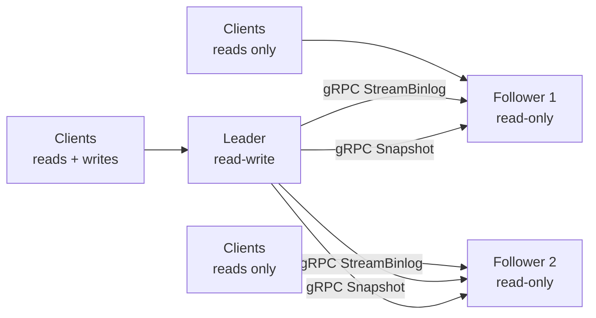
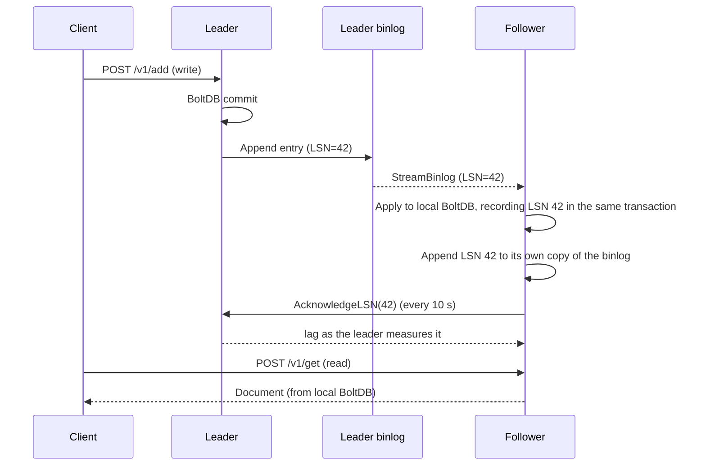
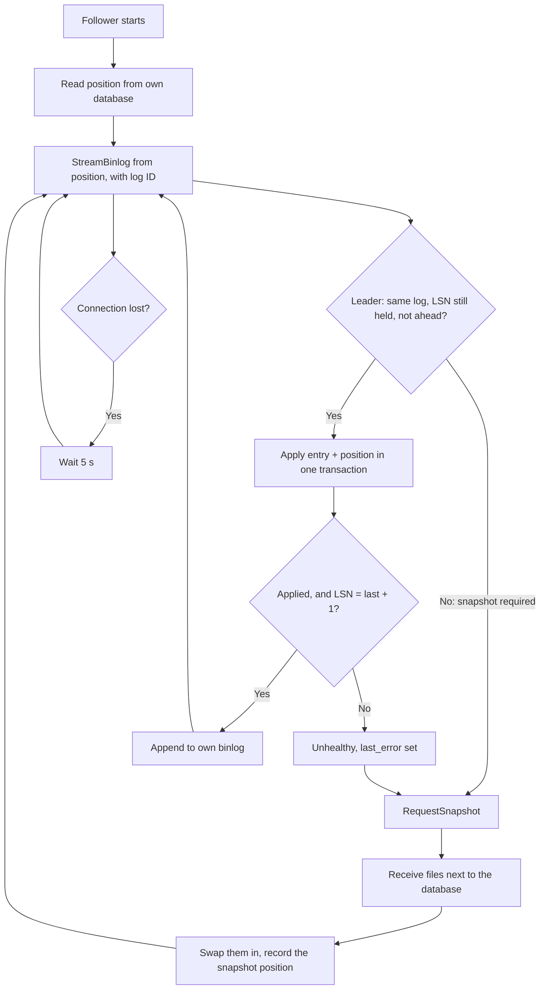

# MDDB Replication (Leader-Follower)

MDDB supports **leader-follower replication** for horizontal read scaling. A single leader node handles all writes and streams changes to one or more read-only follower nodes via a binary replication log (binlog).

With `MDDB_REPLICATION_ROLE` alone, replication is not failover: when the leader stops, followers keep serving reads but nothing is promoted ([Manual failover](#manual-failover)). From 2.19.8 the nodes can elect their leader instead — set `MDDB_CLUSTER_PEERS` and a majority replaces a failed leader, writes on any other node are answered with the leader's address, and a returning old leader sets aside the writes nobody else received ([CLUSTER.md](CLUSTER.md)).

## Architecture



### Replication Flow



### Model

- **Single-leader**: One node accepts writes, followers are read-only
- **Pull-based**: Followers pull changes from the leader via gRPC streaming
- **Eventual consistency**: Followers apply entries after the leader commits them; how far behind a follower is, is measured and reported ([Monitoring](#monitoring))
- **Resume where it stopped**: a follower records its position in its own database and continues from it after a restart or a disconnect
- **Snapshot when the log cannot help**: a new follower, one whose entries the leader no longer keeps, and one that failed to apply an entry receive a full snapshot

## Quick Start

### 1. Start the Leader

```bash
MDDB_REPLICATION_ROLE=leader \
MDDB_REPLICATION_SECRET=change-me-to-32-random-characters \
MDDB_PATH=/data/leader.db \
MDDB_HTTP_PORT=11023 \
MDDB_GRPC_PORT=11024 \
./mddbd
```

The leader automatically enables the binlog and exposes the `MDDBReplication` gRPC service. Without a replication secret, mTLS or authentication it refuses every follower ([Securing replication](#securing-replication)).

### 2. Start a Follower

```bash
MDDB_REPLICATION_ROLE=follower \
MDDB_REPLICATION_LEADER_ADDR=leader-host:11024 \
MDDB_REPLICATION_SECRET=change-me-to-32-random-characters \
MDDB_PATH=/data/follower.db \
MDDB_HTTP_PORT=11033 \
MDDB_GRPC_PORT=11034 \
./mddbd
```

The follower:
- Automatically switches to **read-only mode**
- Connects to the leader's gRPC port
- Resumes from the position recorded in its database, or — starting fresh,
  or when the leader no longer has the entries it needs — downloads a full
  snapshot. The snapshot must pass bbolt's full integrity check before it
  replaces the follower's database ([BACKUP.md](BACKUP.md))
- Tails the binlog for real-time updates

#### How the stream guarantees every entry (v2.15.4)

The leader sends every LSN after the follower's position, once and in order:

- **History is streamed as it is read.** Before 2.15.4 the leader read its
  whole binlog into memory before sending the first entry. A follower starting
  at LSN 0 against a 20 GB binlog got about 1 KB and then nothing for hours.
- **No entry falls between history and live tail.** The stream subscribes
  before it reads the file. An entry written between the two used to reach
  neither.
- **A follower that falls behind catches up from the file.** The live
  subscription is a bounded buffer (4096 entries) and drops what does not fit,
  for example during a bulk import. The stream detects the gap in LSNs, even
  one at the very end of a burst, and reads the missing entries back from the
  binlog. Before 2.15.4 they were silently lost.
- **Reconnecting under the same ID is safe.** The old stream's cleanup used
  to close the new stream's subscription and remove its record, so
  `mddb_replication_followers_connected` showed 0 while data was flowing.
- **A crash during an append does not stop replication.** On startup the
  binlog drops an incomplete last entry. That entry used to stop the server
  from starting, or to stay in the file so that every later entry was
  unreadable.

#### What a follower guarantees (v2.19.8)

- **It applies what has arrived in one go.** Entries are received on their
  own and applied in batches of whatever came in while the last batch was
  being written (up to 1,024 entries), in one transaction per database file,
  with the position recorded in that same transaction. A document write is
  many entries (the document, its key and metadata index, its revision, its
  full-text terms), and a follower that committed — and synced to disk — once
  per entry kept up only on a RAM disk.

- **Its position survives a restart.** The last LSN applied, and the log it
  belongs to, are written by the same transaction that applies the entry
  (bucket `replmeta`, never replicated). A restarted follower asks for the
  entries after it: none applied twice, none skipped, no snapshot. It used to
  keep the position in memory and ask for the log from the start.
- **It never skips an entry.** An entry that does not follow the last one, or
  that cannot be applied, stops the follower: it reports itself unhealthy with
  the reason in `last_error` and replaces its data with a snapshot before it
  applies anything else. It used to log the entry and carry on without it.
- **It refuses a history that is not the leader's.** A follower sends the ID
  of the log its position is in. A leader with another log, or one that has
  not reached the follower's LSN, answers "snapshot required".
- **It keeps its own binlog** with the leader's LSNs, timestamps and log ID —
  a copy of the leader's history on every node ([The follower's binlog](#the-followers-binlog)).

### 3. Verify Replication

```bash
# Write to leader
curl -X POST http://leader-host:11023/v1/add \
  -H "Content-Type: application/json" \
  -d '{
    "collection": "blog",
    "key": "hello",
    "lang": "en_US",
    "contentMd": "# Hello from leader"
  }'

# Read from follower
curl -X POST http://follower-host:11033/v1/get \
  -d '{"collection":"blog","key":"hello","lang":"en_US"}'

# Check replication status
curl http://leader-host:11023/v1/replication/status | jq
```

## Docker Compose

```yaml
services:
  leader:
    image: tradik/mddb:latest
    ports:
      - "11023:11023"
      - "11024:11024"
    volumes:
      - leader-data:/data
    environment:
      MDDB_REPLICATION_ROLE: leader
      MDDB_REPLICATION_SECRET: ${MDDB_REPLICATION_SECRET}
      MDDB_PATH: /data/mddb.db

  follower-1:
    image: tradik/mddb:latest
    ports:
      - "11033:11023"
      - "11034:11024"
    volumes:
      - follower1-data:/data
    environment:
      MDDB_REPLICATION_ROLE: follower
      MDDB_REPLICATION_LEADER_ADDR: leader:11024
      MDDB_REPLICATION_SECRET: ${MDDB_REPLICATION_SECRET}
      MDDB_PATH: /data/mddb.db
    depends_on:
      leader:
        condition: service_healthy

  follower-2:
    image: tradik/mddb:latest
    ports:
      - "11043:11023"
      - "11044:11024"
    volumes:
      - follower2-data:/data
    environment:
      MDDB_REPLICATION_ROLE: follower
      MDDB_REPLICATION_LEADER_ADDR: leader:11024
      MDDB_REPLICATION_SECRET: ${MDDB_REPLICATION_SECRET}
      MDDB_PATH: /data/mddb.db
    depends_on:
      leader:
        condition: service_healthy

  panel:
    image: tradik/mddb:panel
    ports:
      - "3000:3000"
    environment:
      MDDB_SERVER: http://leader:11023 # read by the panel's proxy (server.js)

volumes:
  leader-data:
  follower1-data:
  follower2-data:
```

## Configuration

### Environment Variables

| Variable | Default | Description |
|----------|---------|-------------|
| `MDDB_REPLICATION_ROLE` | `""` (standalone) | Node role: `leader`, `follower`, or empty for standalone |
| `MDDB_REPLICATION_LEADER_ADDR` | - | Follower only: gRPC address of the leader (e.g. `leader:11024`) |
| `MDDB_NODE_ID` | auto-generated | Unique node identifier; a follower is known to the leader by it |
| `MDDB_BINLOG_ENABLED` | `false` | Enable binlog without replication (standalone mode). Auto-enabled for `leader` role. A follower ignores it and keeps its copy of the leader's binlog instead |
| `MDDB_BINLOG_PATH` | `mddb.binlog` next to the DB file | Binlog file path, on a follower too. Its sidecar is `<path>.meta` |
| `MDDB_BINLOG_SYNC` | `interval` | `interval`: an append returns once the entry is buffered; the file is synced about every 100 ms. `commit`: synced before the write returns ([Durability and crashes](#durability-and-crashes)) |
| `MDDB_BINLOG_MAX_SIZE` | `268435456` (256 MB) | Retention trims the binlog when it passes this size ([Retention](#retention)) |
| `MDDB_BINLOG_HARD_MAX_SIZE` | 4 × max size | Size past which entries a follower still needs are dropped too |
| `MDDB_BINLOG_MAX_AGE` | `24h` | Entries older than this are dropped; a disconnected follower is remembered this long |
| `MDDB_REPLICATION_SECRET` | `""` | Shared secret authenticating the snapshot, binlog and acknowledgement calls (SEC-001). Set the **same** value on leader and follower. See [Securing replication](#securing-replication). |
| `MDDB_REPLICATION_TLS` | `false` | Follower: dial the leader over TLS. Implied by any of the three files below |
| `MDDB_REPLICATION_TLS_CA` | system pool | Follower: PEM bundle the leader's certificate is checked against |
| `MDDB_REPLICATION_TLS_CERT` / `MDDB_REPLICATION_TLS_KEY` | - | Follower: client certificate and key, for a leader that requires mTLS |
| `MDDB_REPLICATION_TLS_SERVER_NAME` | host of the leader address | Follower: name the leader's certificate must carry |

These are fixed in the code and have no setting: a follower reconnects 5
seconds after a stream ends (at once when it needs a snapshot), acknowledges
every 10 seconds, and reports unhealthy when the leader measures it more than
30 seconds behind.

### Securing replication

The leader's snapshot and binlog gRPC streams expose the **entire database** — including the `auth_users` (bcrypt password hashes) and `auth_apikeys` buckets — and a live tail of every write. They, and the acknowledgements that decide what the leader's binlog keeps, are therefore gated by `authorizeReplication` (SEC-001), which runs **before** any database access and accepts a request only when one of the following is satisfied:

1. **Shared secret** — set `MDDB_REPLICATION_SECRET` to the same random string (≥ 32 chars) on **both** the leader and every follower. The follower sends it as the `x-mddb-replication-secret` gRPC metadata header; the leader compares it in constant time (`crypto/subtle.ConstantTimeCompare`).
2. **mTLS** — the leader's gRPC listener requires client certificates (`MDDB_TLS_ENABLED=true` with `MDDB_TLS_CLIENT_CA`), and the follower presents one (`MDDB_REPLICATION_TLS_CERT`, `MDDB_REPLICATION_TLS_KEY`, and `MDDB_REPLICATION_TLS_CA` for the leader's CA). A verified client certificate authenticates the follower; no secret needed.
3. **Main auth** — with `MDDB_AUTH_ENABLED=true`, an admin-authenticated context is accepted.

Until 2.19.8 a follower always dialled in plaintext, whatever was configured; with any `MDDB_REPLICATION_TLS*` setting it now dials over TLS and checks the leader's certificate.

> ⚠️ A node started as `leader` with **none** of these configured refuses every `RequestSnapshot`/`StreamBinlog`/`AcknowledgeLSN` call with `PermissionDenied` and logs a loud startup warning. Never expose the gRPC port to an untrusted network without one of the mechanisms above — anyone who can reach it could otherwise exfiltrate the whole database in a single call.

### Role Behavior

| Setting | Writes | Reads | Binlog | Replication |
|---------|--------|-------|--------|-------------|
| (empty / standalone) | Yes | Yes | Off (`MDDB_BINLOG_ENABLED=true` turns it on) | Off |
| `leader` | Yes | Yes | On | Serves followers |
| `follower` | No (read-only) | Yes | Copy of the leader's | Pulls from leader |

### Follower: Disabled Subsystems

When running as a follower, these subsystems are automatically disabled (their results come from the leader's binlog):

- **Embedding Worker** - Embeddings are replicated from the leader
- **TTL Cleanup** - TTL deletions arrive via binlog

## Binlog

The binary replication log records every write operation to BoltDB. It serves as the change stream that followers consume.

### Entry Format

```
[lsn:8][type:1][timestamp:8][bucketNameLen:2][bucketName:N][keyLen:4][key:N][valueLen:4][value:N][checksum:4]
```

| Field | Size | Description |
|-------|------|-------------|
| LSN | 8 bytes | Log Sequence Number; consecutive within a log |
| Type | 1 byte | `1`=Put, `2`=Delete, `3`=DeleteBucket, `4`=Checkpoint |
| Timestamp | 8 bytes | Unix nanoseconds when the leader wrote it |
| BucketName | 2+N bytes | Target BoltDB bucket |
| Key | 4+N bytes | Document key |
| Value | 4+N bytes | Document value (empty for Delete) |
| Checksum | 4 bytes | CRC32 of the entry |

The layout is the one every release has written: a 2.19.7 binlog opens as
it is, and an older release reads one 2.19.8 wrote. A follower refuses an
entry type it does not know instead of skipping it.

### The sidecar

What the file of entries cannot say about itself is in `<binlog>.meta`, a
small JSON file next to it, replaced in one rename:

| Field | Meaning |
|-------|---------|
| `version` | Layout of the sidecar (1) |
| `entryFormat` | Layout of the entries in the log (1, as above) |
| `logId` | Which log this is (16 hex digits). A new log gets a new ID |
| `baseLsn` | The LSN before the first entry in the file — all that is left of the position when retention has emptied the file |
| `state` / `cleanLsn` | `open` while in use; `clean` and the last LSN once closed with everything on disk |

A sidecar with a higher `version` or `entryFormat` than the build knows makes
the server refuse to start rather than misread the log. A binlog without a
sidecar was written before 2.19.8; it is taken as it is, and gets one.

### Durability and crashes

The leader commits a write to BoltDB first and appends its entries to the
binlog afterwards. With `MDDB_BINLOG_SYNC=interval` (the default) the append
is buffered and synced about every 100 ms; with `commit` it is synced before
the write returns, which costs a sync per write. In either mode a process that
dies can leave committed writes that never reached the binlog — the buffered
ones, or one whose append had not started.

Nothing in the file says which. So a leader whose binlog was not closed
cleanly (`state` is not `clean`, or the file does not end at `cleanLsn`) does
not continue it: at start it logs a warning and **begins a new log** under a
new ID, 2^32 LSNs further on so that no position a follower holds can be
mistaken for one in it. Every follower is then told "snapshot required" and
resynchronises. A clean stop, in either mode, keeps the log and its
followers' positions. `commit` narrows what a crash can lose from the binlog;
it does not avoid the resynchronisation after one.

A binlog that fails to take an entry (a write or sync error) takes nothing
more: the leader's status turns unhealthy with `binlog stopped: …`, and the
next start begins a new log. A restore also begins a new log.

### Retention

Retention runs every minute (and is enforced; until 2.19.8 the limits were
stored and never read, and the binlog grew without bound):

- When the file passes `MDDB_BINLOG_MAX_SIZE`, its oldest entries are dropped
  until half of that size is left.
- Entries older than `MDDB_BINLOG_MAX_AGE` are dropped whatever the size.
- **Entries a follower has not acknowledged are kept** past both limits, so a
  follower that is behind or briefly away catches up from the log. The leader
  remembers a disconnected follower for `MDDB_BINLOG_MAX_AGE`, then forgets
  it.
- **Up to a safety cap**: past `MDDB_BINLOG_HARD_MAX_SIZE` the oldest entries
  go even if a follower needs them, and the leader logs that a follower
  behind the cut resynchronises from a snapshot.

A follower whose position is older than what the binlog holds is answered
"LSN too old, snapshot required" and takes a snapshot — also when it starts
from LSN 0 against a binlog that no longer starts at its first entry. That
case used to replay what was left of the log as if it were all of it.

The followers on record are in memory: a leader that restarts keeps entries
only for followers that have reconnected when retention next runs.

### The follower's binlog

A follower writes every entry it applies to its own binlog (at
`MDDB_BINLOG_PATH`, or `mddb.binlog` next to its database), with the leader's
LSNs, timestamps and log ID. The copy is written after the entry is applied;
a follower that stops between the two finds its copy behind its data and
starts the copy again, empty, at the applied position. A snapshot does the
same. Nothing else on a follower writes to it. Retention applies to it by
size and age.

### Performance

- **Buffered I/O**: 256KB write buffer, synced about every 100 ms (`interval`) or on every write (`commit`)
- **Compact format**: Binary serialization
- **Subscriber channels**: Real-time push to followers via Go channels
- **Timestamps of the newest 65,536 entries are kept in memory** to measure lag

## gRPC Replication Service

The leader exposes these gRPC methods on the standard gRPC port:

```protobuf
service MDDBReplication {
    rpc RequestSnapshot(SnapshotRequest) returns (stream SnapshotChunk);
    rpc StreamBinlog(StreamBinlogRequest) returns (stream BinlogEntryProto);
    rpc ReplicationStatus(ReplicationStatusRequest) returns (ReplicationStatusResponse);
    rpc AcknowledgeLSN(AcknowledgeLSNRequest) returns (AcknowledgeLSNResponse);
    // Cluster nodes (MDDB_CLUSTER_PEERS, v2.19.8):
    rpc RequestVote(VoteRequest) returns (VoteResponse);
    rpc Heartbeat(HeartbeatRequest) returns (HeartbeatResponse);
    rpc StepDown(StepDownRequest) returns (StepDownResponse);
}
```

| Method | Description |
|--------|-------------|
| `RequestSnapshot` | Every database file streamed in 1 MB chunks from read transactions (`bolt.Tx.WriteTo()`), each chunk naming its file, then a closing chunk |
| `StreamBinlog` | Historical entries after a given LSN + real-time tailing. Opens with the headers `x-mddb-replication-protocol` and `x-mddb-log-id` |
| `ReplicationStatus` | The same report as `GET /v1/replication/status` |
| `AcknowledgeLSN` | Follower confirms the LSN it has applied. The leader keeps the entries after it (retention) and answers with the follower's lag as it measures it; with `MDDB_REPLICATION_ACK=quorum` it is what a write waits for |
| `RequestVote`, `Heartbeat`, `StepDown` | Elections between cluster nodes, authorised like the streams ([CLUSTER.md](CLUSTER.md)) |

### Versions

Requests carry `protocol_version` (3 in 2.19.8; unset from older releases)
and the leader answers with the `x-mddb-replication-protocol` header, and in
a cluster with `x-mddb-term`. Fields are only ever added: a node leaves out
what an older peer does not know, and an older peer ignores what it does not
read. Protocol 3 adds election terms: every streamed entry and snapshot
carries the term it was written in, and a cluster follower sends its term
and where each term begins in its log. The file layout is unchanged — the
terms are a list in the sidecar — so `entryFormat` stays 1.

## Follower Sync Flow



### Snapshots

1. The leader takes its current LSN and log ID, then streams the main
   database file and, in the per-collection layout, every collection file,
   each from its own read transaction while writes go on. A commit reaches
   the database before its entry reaches the binlog, so every file holds at
   least everything through that LSN; entries after it that a file already
   holds are applied again and leave it as the leader has it.
2. The follower writes the files next to its database, checks them, and swaps
   them in as a restore does (collection files first, put back if the main
   file fails), then records the snapshot's LSN and log ID.
3. The follower resumes `StreamBinlog` from that position.

Leader and follower must use the same `MDDB_STORAGE_LAYOUT`: a snapshot is
the leader's files. A leader refuses a follower in the other layout and says
so. A follower in the per-collection layout cannot take a snapshot from a
leader before 2.19.8, whose snapshots are one file ([STORAGE-LAYOUT.md](STORAGE-LAYOUT.md#limits)).

### Reconnection

- Follower retries 5 seconds after a stream ends
- If the binlog still has the entries after its position: incremental catch-up
- If not (trimmed, a new log after a leader crash or restore, or the follower
  is ahead of the leader): full snapshot

## Monitoring

### HTTP Endpoint

```bash
GET /v1/replication/status
```

**Leader response:**
```json
{
  "node_id": "leader-1",
  "role": "leader",
  "current_lsn": 45230,
  "log_id": "3f9a0c51d2e4b788",
  "binlog_oldest_lsn": 40000,
  "binlog_size_bytes": 15728640,
  "binlog_max_size_bytes": 268435456,
  "binlog_sync": "interval",
  "connected": false,
  "replication_lag_ms": 0,
  "lag_entries": 0,
  "healthy": true,
  "followers": [
    {
      "follower_id": "follower-1",
      "address": "10.0.0.2:51544",
      "confirmed_lsn": 45228,
      "lag_ms": 12,
      "lag_entries": 2,
      "lag_exact": true,
      "last_seen_at": 1709500000,
      "connected": true,
      "status": "healthy"
    }
  ],
  "uptime_seconds": 86400
}
```

**Follower response:**
```json
{
  "node_id": "follower-1",
  "role": "follower",
  "current_lsn": 45228,
  "log_id": "3f9a0c51d2e4b788",
  "binlog_oldest_lsn": 1,
  "binlog_size_bytes": 2097152,
  "binlog_max_size_bytes": 268435456,
  "binlog_sync": "interval",
  "leader_addr": "leader:11024",
  "connected": true,
  "replication_lag_ms": 12,
  "lag_entries": 2,
  "last_applied_at": 1709500000,
  "healthy": true,
  "followers": [],
  "uptime_seconds": 3600
}
```

- `current_lsn` is the last LSN written on a leader and the last LSN applied
  on a follower.
- **Lag is time, measured from the entries' own timestamps**: the age of the
  oldest entry the follower has not confirmed. It used to be the LSN
  difference times ten. The leader keeps the timestamps of its newest 65,536
  entries; for a follower further behind, `lag_ms` is a lower bound and
  `lag_exact` is false. A follower's `replication_lag_ms` is what the leader
  measured at its last acknowledgement, so it is up to 10 seconds old.
- `healthy` is false, with the reason in `last_error`, on a follower that is
  not connected, is waiting for a snapshot, stopped on an entry it could not
  apply, or is more than 30 seconds behind — and on a node whose binlog
  stopped taking entries. It used to be the constant `true`.
- A follower's `status`: `healthy` up to 1 s of lag, `warning` up to 30 s,
  `unhealthy` beyond, `disconnected` when it has no stream (it stays listed
  while the leader remembers it).

The same report is served over gRPC by `ReplicationStatus`.

### Prometheus Metrics

| Metric | Type | Description |
|--------|------|-------------|
| `mddb_replication_role` | gauge | 1=leader, 2=follower, 0=standalone |
| `mddb_replication_lsn` | gauge | Current LSN of the node's binlog (leader, or standalone with a binlog) |
| `mddb_binlog_size_bytes` | gauge | Current binlog file size |
| `mddb_binlog_oldest_lsn` | gauge | Oldest LSN still in the binlog |
| `mddb_replication_followers_connected` | gauge | Binlog streams open on the leader |

Follower lag is in `/v1/replication/status`, not in a metric. The
`ops.replication_lag_high` webhook fires on a follower whose lag passes
`MDDB_INCIDENT_LAG_THRESHOLD_MS`.

### Health Check

`/health` does not report replication. Use `/v1/replication/status`:
`healthy` and `last_error`.

### Web Panel

The admin panel includes a **Cluster** tab (under Administration) that shows:
- Node role and health, with the reason when it is not healthy
- LSN, log ID and binlog size against its limit
- The followers the leader knows, with lag in time and in entries
- Lag history chart (last 5 minutes, sampled while the tab is open)

## What Gets Replicated

Everything written through a path that records binlog entries. Every such
path records them inside the write's own transaction (2.19.8), so the log
holds the writes in the order the database committed them. The extreme-mode
batch path — on whenever HTTP/3 is enabled (`MDDB_HTTP3_ENABLED`, or the
legacy `MDDB_EXTREME`) — used to write documents without any log entries, so
batches sent to such a leader never reached its followers; it records them
now. Each manager whose bucket a batch touches is
reloaded once per batch, not once per entry.

| Subsystem | Replicated | Notes |
|-----------|:----------:|-------|
| Documents (CRUD) | Yes | All Put/Delete to `docs` bucket |
| Revisions | Yes | All revision entries |
| Metadata indices | Yes | `idxmeta`, `bykey` buckets |
| Vector embeddings | Yes | `vectors` bucket; the follower adds them to its in-memory indexes |
| Full-text index | Yes | FTS tokens in BoltDB |
| Geo points | Yes | `geo` bucket; the follower adds them to its in-memory geo indexes (2.19.8; before, only at its next start or `POST /v1/geo-reindex`) |
| Webhooks, schemas, automations, aliases, collection configs, module switches, chat scenarios and skills | Yes | Config in BoltDB; the follower reloads its in-memory copy |
| Tenant quotas and limits, curation rules, synonyms, stop words | Yes | Config in BoltDB; the follower reloads its in-memory copy as it applies the batch (2.19.8; before, only at its next start) |
| Auth (users, API keys) | Snapshot only | In the files a snapshot carries; later changes on the leader are not streamed |

## Limitations

- **Single leader**: Only one node can accept writes. Multi-leader is not supported.
- **Eventual consistency**: Followers may serve slightly stale reads during replication lag.
- **No automatic failover without a cluster**: with `MDDB_REPLICATION_ROLE` alone, promoting a follower requires manual reconfiguration. With `MDDB_CLUSTER_PEERS` and three or more nodes the leader is elected ([CLUSTER.md](CLUSTER.md)).
- **A leader crash costs every follower a snapshot** ([Durability and crashes](#durability-and-crashes)).
- **Binlog retention**: a follower behind the hard size limit, or gone longer than `MDDB_BINLOG_MAX_AGE`, resynchronises from a snapshot.
- **Same storage layout** on leader and follower for snapshots.
- **gRPC only**: Replication uses gRPC (port 11024). Both leader and follower must have gRPC ports accessible.
- **Upgrade followers first** across an on-disk format change: each server migrates its own files at startup, and a follower applies key-index entries from an older leader in the new form, but a follower on an older release does not understand the new form ([STORAGE-LAYOUT.md](STORAGE-LAYOUT.md#schema-version)).

## Upgrading to 2.19.8

Moving to a cluster with elections is described in
[CLUSTER.md](CLUSTER.md#upgrading). Without `MDDB_CLUSTER_PEERS` the notes
below apply.

Upgrade **followers first**, then the leader. Every combination keeps
replicating; what differs is when a follower takes a snapshot:

- **A 2.19.8 follower of an older leader** starts without a recorded
  position, asks for the log from LSN 0 and applies what the leader still
  has, as before; if that log no longer starts at its first entry, the
  follower notices the gap and takes a snapshot. In the per-collection layout
  it cannot take one from an older leader (one-file snapshots).
- **A 2.19.8 leader** keeps its existing binlog, gets a sidecar on the first
  start and enforces retention from then on.
- **An older follower of a 2.19.8 leader** keeps streaming while it stays
  connected. After a restart it asks for the log from LSN 0 again; a 2.19.8
  leader whose binlog no longer starts at its first entry refuses that, and an
  older follower does not act on the refusal — it retries until it is
  upgraded.

## Examples

### Load Balancer Setup (Nginx)

Route writes to leader, reads to any node:

```nginx
upstream mddb_read {
    server leader:11023;
    server follower-1:11033;
    server follower-2:11043;
}

upstream mddb_write {
    server leader:11023;
}

server {
    listen 80;

    # Write endpoints -> leader only
    location ~ ^/v1/(add|delete|import-url|set-ttl|webhooks|schema|truncate|restore) {
        proxy_pass http://mddb_write;
    }

    # Read endpoints -> any node
    location /v1/ {
        proxy_pass http://mddb_read;
    }
}
```

### Kubernetes StatefulSet

```yaml
apiVersion: apps/v1
kind: StatefulSet
metadata:
  name: mddb-follower
spec:
  replicas: 3
  selector:
    matchLabels:
      app: mddb-follower
  template:
    metadata:
      labels:
        app: mddb-follower
    spec:
      containers:
        - name: mddb
          image: tradik/mddb:latest
          env:
            - name: MDDB_REPLICATION_ROLE
              value: "follower"
            - name: MDDB_REPLICATION_LEADER_ADDR
              value: "mddb-leader.default.svc.cluster.local:11024"
            - name: MDDB_REPLICATION_SECRET
              valueFrom:
                secretKeyRef:
                  name: mddb-replication
                  key: secret
            - name: MDDB_PATH
              value: "/data/mddb.db"
          ports:
            - containerPort: 11023
            - containerPort: 11024
          volumeMounts:
            - name: data
              mountPath: /data
  volumeClaimTemplates:
    - metadata:
        name: data
      spec:
        accessModes: ["ReadWriteOnce"]
        resources:
          requests:
            storage: 10Gi
```

### Manual Failover

In a cluster (`MDDB_CLUSTER_PEERS`) use `POST /v1/replication/promote` or
`mddb-cli replication promote` instead: it checks that no reachable node has
a later log and moves the other nodes to the new leader
([CLUSTER.md](CLUSTER.md#promotion-and-demotion)). Without a cluster, if the
leader goes down:

```bash
# 1. Stop the failed leader

# 2. Promote a follower to leader
MDDB_REPLICATION_ROLE=leader \
MDDB_REPLICATION_SECRET=change-me-to-32-random-characters \
MDDB_PATH=/data/mddb.db \
MDDB_HTTP_PORT=11023 \
MDDB_GRPC_PORT=11024 \
./mddbd

# 3. Point other followers to the new leader
# Update MDDB_REPLICATION_LEADER_ADDR and restart
```

The promoted node removes its follower position and opens its copy of the
old leader's binlog as its own. A follower that was stopped cleanly continues
that log, under the same log ID: the other followers continue from it, and
one that had applied more than the promoted node is refused as ahead of the
leader and takes a snapshot. A follower that was not stopped cleanly starts a
new log, and every other follower takes a snapshot.

## Troubleshooting

| Symptom | Cause | Fix |
|---------|-------|-----|
| Follower stuck at LSN 0, `connected: false` | Can't connect to leader | Check `MDDB_REPLICATION_LEADER_ADDR`, firewall rules, the secret or TLS settings; `last_error` says what failed |
| "snapshot required" in the follower log | Binlog trimmed, a new log after a leader crash or restore, or the follower ahead of the leader | Nothing: the follower takes a snapshot |
| "the leader stores data in the … layout" | Leader and follower in different storage layouts | Convert the stopped follower (`-split-collections` / `-merge-collections`) |
| `last_error: replication stopped, resynchronising from a snapshot` | An entry the follower could not apply | Nothing: it resynchronises; the error names the entry |
| High replication lag | Slow network or overloaded follower | Check network, reduce write load, add followers |
| Leader `healthy: false`, `binlog stopped` | The binlog could not write or sync | Check disk space and permissions; restart the leader (a new log, followers resynchronise) |
| "binlog not enabled" | Leader not configured | Set `MDDB_REPLICATION_ROLE=leader` |

**[Back to Documentation](README.md)**
